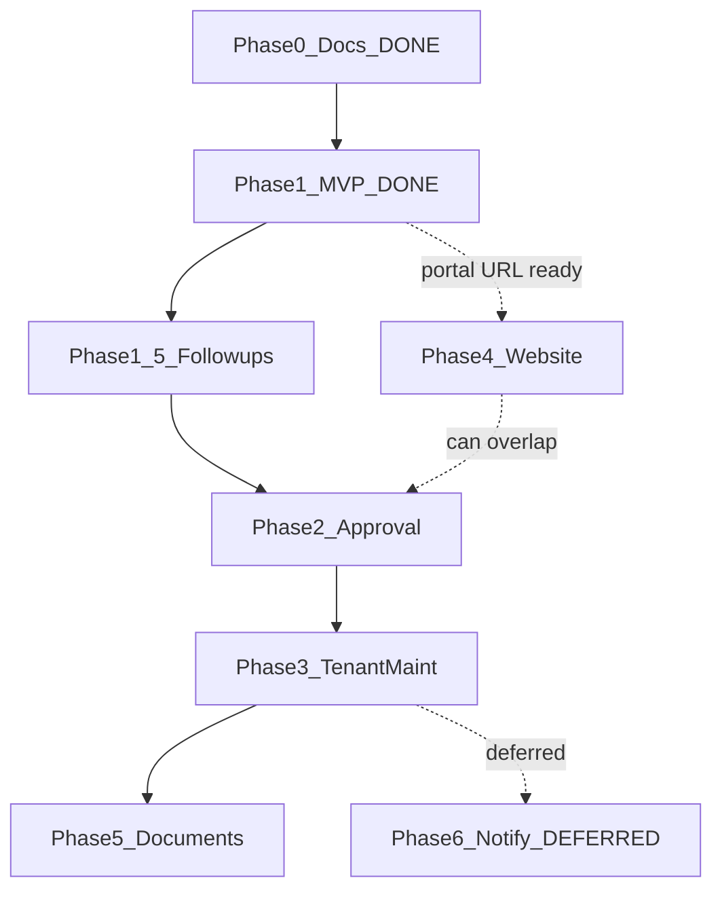

# Landlord Gopher — Phased Implementation Plan

**Last revised:** 2026-11-13  
**Tracker:** Cursor Project task list (this doc is the source of truth for scope; Project tasks mirror phases/requirements below).  
**LGA-5:** Correction plan before Phase 2 — completion checklist in [Coordinator runbook](#lga-5--correction-plan-before-phase-2).

## Branch / merge status

| Item | Status |
|------|--------|
| Phase 0–1 | Merged (PR #1) |
| Cursor review skills | Merged (PR #2) under `.cursor/skills/` |
| Plan revision (Phase 0–1 done + defer notify) | Merged (PR #3) |
| Phase 1.5 / deferred tracking | Merged (PRs #5–#7, #9) |
| Phase 2 feature work | Merged (PR #8) |
| Phase 3 tenant maintenance | Merged (PR #10) |
| Phase 5 property documents | Branch `cursor/phase5-property-documents-0924` (LGA-10) |
| Nov 9 WO port | Covered by Phase 3 status/photos UI (or deferred leftovers) |

## Status snapshot

| Phase | Focus | Status |
|-------|--------|--------|
| **0** | Planning docs / schema tracker | **Done** (merged via PR #1) |
| **1** | Auth, RLS, Supabase data cutover, landlords | **Done** (merged via PR #1; optional manual QA + small leftovers remain) |
| **1.5** | Phase 1 follow-ups (UX AuthZ + lease-dialog) | **Done** (merged; residual polish in deferred-work) |
| **2** | Account approval UI + Applications UI | **Done** (merged PR #8) |
| **3** | Tenant maintenance + photos + status history | **Done** (merged PR #10) |
| **4** | Website CTA + shared Auth links | Planned (can overlap Phase 2 once portal URL is stable) |
| **5** | Property documents | Implemented (branch `cursor/phase5-property-documents-0924`) |
| **6** | Email / push / messaging notifications | **Deferred** — use in-app popups/toasts for now |

---

## Verified facts (updated after Phase 0–1)

**Verified**
- Repo: [maintenance-app-portal](https://github.com/charmzoned/maintenance-app-portal) — React 19 + Vite; product path is **Supabase** (Auth + PostgREST + Storage), not D1.
- Phase 0–1 merged to `master` (PR #1 / `cursor/phase0-phase1-mvp-8ed9`).
- Client uses `@supabase/supabase-js` (`VITE_SUPABASE_URL` / `VITE_SUPABASE_ANON_KEY`); open Hono `/api/*` returns **410**.
- Live Supabase project **Landlord Gopher** (`bgjkjtfgrfiszbzatriq`) shared with marketing site.
- `user_roles.account_status` (`pending|approved|rejected|suspended`); app gate + SQL helpers require `approved`.
- Staff/admin portal: dashboard, landlords, properties, units, tenants, leases, rent, maintenance, vendors, settings against Supabase with RLS.
- Marketing site [`LandlordGopherWebsite`](https://github.com/CharmZoned/LandlordGopherWebsite) still separate (Next.js); inquiries via service role.

**Decisions (locked)**
- Same Supabase project as the website.
- Keep this React portal UI; D1/Hono is legacy (retired for product reads/writes).
- MVP remaining = **Phase 2** (account approval + Applications UI).
- "Account approval" = user `account_status`, **not** rental `Applications`.
- **Defer messaging and notifications (email/push/in-app message center).** Near-term feedback = **web app popups/toasts/dialogs** only. Revisit as Phase 6 later.
- Document visibility (when Phase 5 lands): admin sets `tenant` \| `staff` \| `landlord`.
- Accept & schedule / OK maintenance orders: **admin only** (when richer WO UI lands).
- Signup path (Phase 2): email signup → verification → `pending` until admin approves.

---

## Requirement map (R1–R8) — revised after Phase 0–1

Status reflects **shipped portal code on `master`**, not the original gap table.

| ID | Requirement | Status | Done in Phase 0–1 | Main gap / next phase |
|----|-------------|--------|-------------------|----------------------|
| **R1** | Accounts and login | **Partial** | Login, logout, password reset, session restore, role gate (`admin` / staff-linked) | Public signup + email-verify UX; richer role linking for landlord/tenant self-serve → **Phase 2** |
| **R2** | Account approval | **Partial** | `account_status` column; unapproved users blocked in UI + RLS helpers | No admin Users queue (approve/reject/suspend); no Applications UI → **Phase 2** |
| **R3** | Properties and units | **Done (staff MVP)** | Landlords CRUD; properties require `landlord_id`; units/tenants/leases on Supabase | Landlord self-serve portal later (out of MVP); keep polishing via normal CRUD |
| **R4** | Maintenance requests | **Mostly done (Phase 3)** | Staff WOs + tenant submit/photos/status history/comments on branch | Merge Phase 3; optional richer Accept & schedule UX (deferred) |
| **R5** | Property documents | **Partial (Phase 5)** | Table + bucket + RLS; staff/admin UI; tenant Documents page | Landlord portal docs UI deferred |
| **R6** | Notifications / messaging | **Deferred** | — | No email, push, or messaging. Use **popups/toasts** in the web app for operator feedback until Phase 6 is reopened |
| **R7** | Permissions | **Mostly done** | Auth required; JWT client; RLS on core tables; D1 API retired | Applications RLS; leftover AuthZ UX for `maintenance` role mutates; optional FORCE RLS → **Phase 1.5 / 2** |
| **R8** | Admin web portal | **Partial** | Staff/admin auth gate + portfolio screens | Users/approvals, Applications, documents; not a public unauthenticated dashboard anymore → **Phase 2** then **5** |

---

## Cursor Project task list (mirror these)

Create/update Project tasks so the list tracks planned work (not the old “everything not started” gap table):

| Task | Status category | Notes |
|------|-----------------|-------|
| Phase 0 — Planning docs | **Done** | Merged |
| Phase 1 — Auth / RLS / Supabase / landlords | **Done** | Merged; manual QA checklist optional |
| Phase 1.5 — Follow-ups (isAdmin mutate UI, lease-dialog, optional FORCE RLS) | Queued / next | See [`docs/phases/phase-2.md`](phases/phase-2.md) leftovers section once expanded |
| Phase 2 — Account approval + Applications UI (R2, R8) | Queued | Next major product phase |
| Phase 3 — Tenant maintenance + photos + history (R4) | In progress / PR | Branch `cursor/phase3-tenant-maintenance-0924` |
| Phase 4 — Website CTA + shared Auth (portal URL) | Queued | Can overlap Phase 2 |
| Phase 5 — Property documents (R5) | In progress / review | Branch `cursor/phase5-property-documents-0924` |
| Phase 6 — Email / push / messaging (R6) | **Canceled / Deferred** | Explicit hold; popups only for now |
| R3 Properties & units (staff) | **Done** | Covered by Phase 1 |
| R7 Permissions (core) | **Done** (with known leftovers in 1.5) | Covered by Phase 1 |

Do **not** create active tasks for messaging threads or notification email until Phase 6 is deliberately reopened.

---

## Standing agent roles

| Role | Owns | Forbidden without sync |
|------|------|------------------------|
| **BE** | `supabase/migrations/**`, RLS, Storage, Auth helpers/RPCs, types | Portal UI components |
| **FE** | Auth screens, shell, CRUD pages, `src/client/**` | Raw SQL / live DB writes |
| **WEB** | `LandlordGopherWebsite` nav/CTA, env, deep links | Portal schema |
| **QA** | Checklists, RLS verification, “ready for review” | Shipping features without BE/FE DoD |

Branches: `cursor/phaseN-<topic>-0924` (or existing `-8ed9` series). Stack dependent PRs.

---

## Phase 0 — Planning tracker — DONE

- [`docs/IMPLEMENTATION_PLAN.md`](IMPLEMENTATION_PLAN.md), [`docs/supabase-schema.md`](supabase-schema.md), [`docs/phases/`](phases/) committed and merged.

---

## Phase 1 — MVP foundation (R1, R7, R8 core, R3) — DONE

**Delivered:** Staff/admin sign-in; portfolio screens on Supabase with RLS; landlords required on properties; client no longer calls `/api` for product data; `/api` → 410.

**Evidence:** `src/client/lib/supabase.ts`, `data.ts`, `mappers.ts`, auth hooks/gate, `supabase/migrations/*`, [`docs/phases/phase-1.md`](phases/phase-1.md).

**Remaining (Phase 1.5, not Phase 2 product):**
- ~~Gate portfolio mutate UI on `isAdmin`~~ / ~~lease-dialog effect~~ — done on `master` (`3fc7a64`).
- ~~Payment ledger RPC, `FORCE ROW LEVEL SECURITY`, narrow `vendors_select`~~ — Phase 1.5 migration.
- Parked Should/Perf (RPC tests, generateCharges soft-fail, dashboard N+1) — [`docs/deferred-work.md`](deferred-work.md).
- Manual QA checklist in phase-1.md (env + seeded admin).

**Out of scope (still later phases):** approval queue UI, tenant submit, website repo, documents, notifications.

---

## Phase 2 — Account approval + Applications UI (R2, R8) — NEXT

**Already from Phase 1 (do not rebuild):** `account_status`; app `unapproved` gate; SQL helpers require `approved`.

| Step | Agent | Work |
|------|-------|------|
| P2a | BE | Admin-only status update policies/RPC; Applications read/write RLS |
| P2b | FE | Admin Users page: pending / approve / reject / suspend; signup → pending (+ email verify) |
| P2c | FE | Applications list/detail (rental applicants) — clearly labeled |
| P2d | QA | Pending blocked; approve unlocks; reject/suspend stick |

**DoD:** Pending users cannot use portal; admin can approve; Applications UI ≠ account approval.  
**Detail:** [`docs/phases/phase-2.md`](phases/phase-2.md)

---

## Phase 3 — Tenant maintenance + photos (R4, R7) — IMPLEMENTED (merge pending)

| Step | Agent | Work |
|------|-------|------|
| P3a | BE | Status history table + trigger; reuse photo bucket/RLS; tenant approve gates; admin-only Accept & schedule |
| P3b | FE | Tenant shell: submit (category, description, permission_to_enter, photos); list own |
| P3c | FE | Staff maintenance UI: category, photos, comments, status history; admin-only Accept & schedule |
| P3d | QA | typecheck/build; checklist in [`docs/phases/phase-3.md`](phases/phase-3.md) |

**DoD:** Tenant submits with photo; staff status trail; comments visibility respected.  
Near-term alerts = **in-app popups/toasts**, not email/push.  
**Detail:** [`docs/phases/phase-3.md`](phases/phase-3.md)

---

## Phase 4 — Website integration

| Step | Agent | Work |
|------|-------|------|
| P4a | WEB | CTA → `NEXT_PUBLIC_PORTAL_URL`; Staff / Tenant login copy |
| P4b | FE | Login `?redirect=` / branding aligned with site |
| P4c | QA | Site → portal login → shared Auth session |

**Start when:** Phase 1 portal URL + Auth env stable (may overlap Phase 2).

---

## Phase 5 — Property documents (R5) — IMPLEMENTED (PR pending)

| Step | Agent | Work | Done |
|------|-------|------|------|
| P5a | BE | `PropertyDocuments` + private bucket; admin visibility `tenant`\|`staff`\|`landlord` | [x] |
| P5b | FE | Upload/list/download on property (and unit if linked); tenant Documents page | [x] |
| P5c | QA | Tenant only reads tenant-visible docs; landlord scoped (RLS) | [x] |

**Detail:** [`docs/phases/phase-5.md`](phases/phase-5.md)

---

## Phase 6 — Notifications & messaging (R6) — DEFERRED

**Hold:** email alerts, push, in-app message center, staff↔tenant/landlord messaging threads.

**Interim:** use existing web UI patterns (dialogs, toasts, confirm popups) for staff feedback.

When reopened: Edge Function/email for maintenance create/status change; optional in-app list; messaging as a separate design (not WO comments).

---

## LGA-5 — Correction plan before Phase 2

**Goal of LGA-5:** Lock product decisions, land the revised tracker on `master`, sync the Cursor Project list — **without** starting Phase 2 feature code.

**Out of LGA-5 (separate tasks):** Phase 1.5 code fixes, Phase 2 Users/Applications UI, Nov 9 WO port, Phase 6 notify/messaging.

### Done already

- [x] Phase 0–1 merged (PR #1)
- [x] Review skills on `master` (PR #2)
- [x] Locked decisions: admin-only doc visibility; admin-only Accept & schedule; signup→verify→pending; **defer** email/push/messaging (popups only)
- [x] Revised `docs/IMPLEMENTATION_PLAN.md` + phase briefs on branch `cursor/revise-implementation-plan-0924`
- [x] Open [PR #3](https://github.com/CharmZoned/Maintenance-App-Portal/pull/3) (rebase/merge onto current `master` required — was dirty)

### Remaining to close LGA-5

| Step | Who | Action | Exit criteria |
|------|-----|--------|---------------|
| **A1** | Agent | Rebase/merge PR #3 onto latest `master`; resolve doc conflicts (keep this revised tracker; drop superseded “messaging Phase 2.5” near-term work) | PR mergeable (not dirty) |
| **A2** | User | Review + merge [PR #3](https://github.com/CharmZoned/Maintenance-App-Portal/pull/3) | Tracker live on `master` |
| **A3** | Coordinator | Sync Cursor Project tasks to the mirror table above; mark LGA-5 **Done**; ensure Phase 6 / messaging tasks are Deferred/Canceled | List matches plan |
| **A4** | Coordinator | Abandon or close stale `cursor/plan-product-gaps-2880` (superseded by PR #3) | One plan branch only |
| **A5** | Optional | Confirm Phase 2 open questions (signup vs invite; email in Users list without service role) — non-blocking notes in phase-2.md | Written answers or “decide in P2a” |

**LGA-5 DoD:** PR #3 merged; Project list synced; correction decisions reflected in tracker; Phase 2 agents may start (or Phase 1.5 first if multi-staff prod is imminent).

### After LGA-5

1. Optional **Phase 1.5** (isAdmin mutate UI + lease-dialog) — recommended before multi-staff prod; does not block Phase 2 planning acceptance.
2. Spawn **Phase 2** agents: P2a → P2b ‖ P2c → P2d.
3. Optionally start **Phase 4** once a stable portal URL exists.
4. Phase 3 → 5 later; Phase 6 stays parked.

**Open questions (non-blocking for LGA-5):**
1. Portal host (Cloudflare Pages vs Vercel).
2. Public signup vs invite-only for staff (Phase 2).
3. Tenant UI in same SPA vs subdomain (recommend same SPA + role routes).
