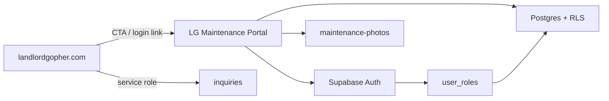
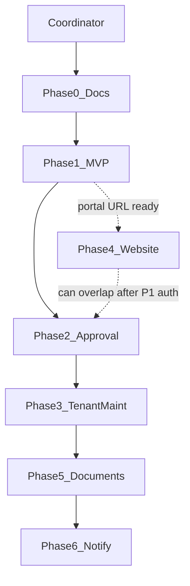
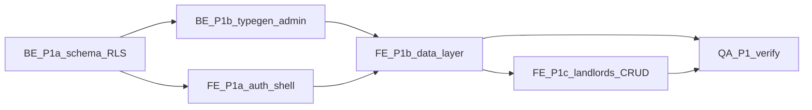

# Landlord Gopher — Phased Implementation Plan

## Verified facts vs assumptions

**Verified**
- This repo ([maintenance-app-portal](https://github.com/charmzoned/maintenance-app-portal)) is **OpenProperty**: React 19 + Vite + Hono on **Cloudflare Workers + D1**, not Supabase. Nav title is already "LG Maintenance Portal". No `AGENTS.md`. No auth/login/session code. All `/api/*` routes are open. Schema in [`src/server/schema.sql`](src/server/schema.sql); routes in [`src/server/index.ts`](src/server/index.ts).
- README lists public tenant/owner portals and email as **intentionally out of scope** for the Clawnify template — conflicts with your product requirements.
- There is **no** `docs/` tracker in-repo (only `README.md`). Planning docs will be created as [`docs/IMPLEMENTATION_PLAN.md`](docs/IMPLEMENTATION_PLAN.md) after you approve this plan.
- Marketing site [`LandlordGopherWebsite`](https://github.com/CharmZoned/LandlordGopherWebsite) is Next.js; uses Supabase only for `inquiries` (service-role insert; RLS on, no policies). Canonical site URL default `https://landlordgopher.com`.
- Supabase project **Landlord Gopher** (`bgjkjtfgrfiszbzatriq`) already has empty domain tables: `Landlords`, `Properties` (with `landlord_id`), `Units`, `Tenants`, `Staff`, `Leases`, `LeaseTenants`, `RentCharges`, `Payments`, `Vendors`, `Applications`, `Settings`, `MaintenanceRequests` (+ photos/comments), `user_roles`, plus `inquiries`. Roles enum used in RLS: `admin` | `landlord` | `tenant` | `maintenance`. Private helpers exist (`current_role`, `handle_new_user`, etc.). Bucket `maintenance-photos` (private). Advisors: RLS enabled **without policies** on Applications, Leases, LeaseTenants, RentCharges, Payments, Vendors, Settings, inquiries.
- `Landlord-Gopher-Portal` GitHub repo is effectively empty ("read me test"). Mobile repo exists separately and is out of this plan unless you expand scope.

**Decisions (locked — you agreed with the plan)**
- Reuse the **same** Supabase project as the website (`bgjkjtfgrfiszbzatriq`).
- Keep this React portal UI; **replace D1/Hono** with Supabase client (Auth + PostgREST + Storage), adapting field names to the live schema.
- MVP = **Phase 1 + Phase 2** (staff/admin + auth + approval); tenant maintenance = Phase 3; website CTA = Phase 4; documents = Phase 5; notifications = Phase 6.
- Website integration MVP = nav/CTA links + shared Auth project (not SSO iframe in Phase 1).
- "Account approval" is **user account** status (pending/approve/reject/suspend), **not** rental `Applications` records.
- On execute: commit overall tracker to [`docs/IMPLEMENTATION_PLAN.md`](docs/IMPLEMENTATION_PLAN.md) plus per-phase agent briefs under [`docs/phases/`](docs/phases/).

---

## Requirement map (R1–R8)

Do not treat README checklists as done. Status is vs **this app’s code**, with Supabase schema noted separately.

| ID | Description | Status | Evidence | Remaining work / acceptance |
|----|-------------|--------|----------|-----------------------------|
| **R1** Accounts and login | Missing in app | No users/passwords/sessions in portal; Supabase Auth exists platform-side; `user_roles` + `handle_new_user` in DB | Wire `@supabase/supabase-js`, signup/login/verify/reset/logout UI; map Auth user → `user_roles` + Staff/Landlord/Tenant row; AC: unauthenticated users cannot load portfolio data |
| **R2** Account approval | Missing | No pending/approve/reject/suspend; `Applications` is rental applicants (API in Hono, **no UI**); Supabase `Applications` has RLS but no policies | Add `account_status` (or equivalent) + staff approval UI; do **not** overload rental Applications; AC: new accounts blocked until approved (except bootstrap admin) |
| **R3** Properties and units | Partial in app; stronger in Supabase | App: CRUD properties/units + lease→tenant. No landlord entity in D1. Supabase: `Landlords` + `Properties.landlord_id` already | Point UI at Supabase; require landlord on property create; staff landlord management screens; AC: every property has landlord; units CRUD under property |
| **R4** Maintenance requests | Partial | App work orders: description, priority, statuses open→cancelled; staff-only; no category/photos/history UI. Supabase: `MaintenanceRequests` with category, photos, comments, tenant insert RLS | Map work-order UI to Supabase model; tenant submit path; photo upload to bucket; status history (table or comment audit); AC: tenant submits with category+photos; staff updates status with trail |
| **R5** Property documents | Missing | No documents table/routes/storage beyond maintenance photos | New `PropertyDocuments` (+ Storage bucket) + staff upload/list/download; AC: staff attach docs to property/unit with RLS |
| **R6** Notifications | Missing | No email/push/in-app | Start with in-app + email on request create/status change (Resend/Supabase); push later; AC: staff alerted on new tenant request |
| **R7** Permissions | Missing in app; partial in DB | All Hono routes unauthenticated. Supabase RLS present for landlords/properties/units/tenants/staff/maintenance/user_roles; **gaps** on leases/rent/vendors/settings/applications | Kill open D1 API or protect it; client uses user JWT; fill missing RLS; AC: role A cannot read role B’s rows |
| **R8** Admin web portal | Partial | Dashboard, properties, tenants, leases, rent, maintenance, settings exist; no users/approvals/messages/documents; not staff-gated | Auth gate + role-based nav; user/approval admin; documents; optional messages; AC: only approved staff/admin reach admin routes |

**Conflicts / outdated items**
- Your gap table matches the **portal app**, but understates Supabase (landlords, category, photos, roles, RLS helpers already exist).
- README “no public portals / no email” is obsolete for Landlord Gopher product goals.
- Field naming differs (D1 `name` vs Supabase `property_name` / `unit_label`; work_orders vs MaintenanceRequests; status casing).

---

## When multi-agent starts

| Moment | What happens |
|--------|----------------|
| **Now (plan mode)** | Single coordinator iterates the plan. No feature agents. |
| **On execute** | Coordinator commits Phase 0 docs, then **spawns Phase 1 agents** (first real multi-agent run). |
| **Phase 1 complete + reviewed** | Coordinator opens Phase 2 agents (new workers / new stacked PRs). |
| **Each later phase** | Same pattern: freeze inputs from prior phase → spawn role agents → Testing merges last → user review → next phase. |

Multi-agent is **per phase**, not one forever-running swarm. The coordinator owns sequencing, PR stacking, and shared files (`docs/`, `src/client/api.ts`, migrations). Agents never start the next phase without a green Testing handoff and your go-ahead if the phase DoD needs product judgment.

Phase 4 (website CTA) may start in parallel with Phase 2 once Phase 1 has a stable portal URL and Auth project config — it does not need tenant maintenance.

---

## Standing agent roles

| Role id | Name | Owns | Forbidden without sync |
|---------|------|------|------------------------|
| **BE** | Supabase/Backend | `supabase/migrations/**`, RLS, Storage buckets, Auth triggers/Edge Functions, generated types | `src/client/components/**` UI |
| **FE** | Frontend/Design | Auth screens, shell, CRUD pages, branding, `src/client/**` (except waiting on BE types) | Raw SQL / live DB writes |
| **WEB** | Website integration | `LandlordGopherWebsite` nav/CTA, env, auth deep links | Portal schema or portal routes |
| **QA** | Testing/Review | RLS SQL tests, manual/Playwright scripts, security checklist, “ready for review” note | Shipping feature commits without BE/FE DoD |

**Shared-file rules**
- Only **BE** edits migrations; FE consumes `src/client/types.supabase.ts` (or equivalent) after BE typegen.
- Only **one** agent owns `src/client/api.ts` / data hooks per PR stack step (usually FE after BE contract is merged or stacked underneath).
- Branches: `cursor/phaseN-<topic>-8ed9`; stack child PRs on parent when dependent.
- Each agent writes a short handoff in the phase doc checkboxes when done.

---

## Phase 0 — Planning tracker (coordinator only)

- Write [`docs/IMPLEMENTATION_PLAN.md`](docs/IMPLEMENTATION_PLAN.md) (this overall plan + R1–R8 + decisions).
- Write [`docs/supabase-schema.md`](docs/supabase-schema.md) (tables, RLS summary, helpers, bucket).
- Write stubs [`docs/phases/phase-1.md`](docs/phases/phase-1.md) … `phase-6.md` (copy agent packages below).
- **Agents:** none. **DoD:** docs committed; no feature/DB/deploy changes.

---

## Phase 1 — MVP foundation (R1, R7, R8 core, R3) — agent detail

**Goal:** Staff/admin sign in and run the existing portfolio screens against Supabase with RLS; every property has a landlord; open D1 API is no longer the product path.

### Phase 1 dependency graph

### Agent packages (spawn these workers)

**1. BE — P1a Schema & RLS freeze** (starts first; blocks FE data work)
- **Branch:** `cursor/phase1-supabase-rls-8ed9`
- **Tasks:**
  - Add `supabase/migrations/` to this repo mirroring live project; migration for `account_status` on `user_roles` (or `profiles`) with values `pending | approved | rejected | suspended` (Phase 2 will enforce UI; Phase 1 may treat missing status as approved for bootstrap admin only — document choice in migration comments).
  - Add RLS policies for `Leases`, `LeaseTenants`, `RentCharges`, `Payments`, `Vendors`, `Settings` (admin/staff/landlord scoped using existing `private.*` helpers).
  - Confirm `handle_new_user` / `assign_admin`; document how to bootstrap first admin.
  - Do **not** change maintenance photo policies except as needed for staff admin path.
- **Files:** `supabase/migrations/*`, `docs/supabase-schema.md` update.
- **Acceptance:** Advisors no longer flag those tables as RLS-with-no-policy; SQL policy tests for admin vs landlord vs anon.
- **Handoff to FE:** published column map D1→Supabase + typegen file.

**2. FE — P1a Auth shell** (parallel with BE P1a after env vars known)
- **Branch:** `cursor/phase1-auth-ui-8ed9` (stack on BE when integrating, or land independently if using mocks)
- **Tasks:**
  - Add `@supabase/supabase-js`; `VITE_SUPABASE_URL` / `VITE_SUPABASE_ANON_KEY`.
  - Screens: login, logout, password reset request/confirm, session restore.
  - App shell: unauthenticated → login; authenticated but no `user_roles` → blocked message; role `admin` or staff-linked → existing nav.
  - Branding pass: LG title already present; pull logo/colors from website assets where practical.
- **Files:** `src/client/lib/supabase.ts`, auth components, `app.tsx` gate, env example.
- **Acceptance:** Manual login/logout; refresh keeps session; anon never hits portfolio queries.
- **Does not:** swap CRUD to Supabase yet (that is FE P1b).

**3. BE — P1b Typegen & admin seed** (after P1a)
- Generate TS types from Supabase; commit types.
- Script or documented SQL to create first admin Auth user + `user_roles` + `Staff` row.
- **Acceptance:** FE can import types; admin seed steps work in a fresh Auth user.

**4. FE — P1b Data-layer cutover** (after BE P1a+P1b + FE P1a)
- **Branch:** `cursor/phase1-supabase-data-8ed9` (stack on auth + RLS)
- **Tasks:**
  - Replace `src/client/api.ts` / `use-app-state` Hono fetches with Supabase queries/mutations matching current screens (properties, units, tenants, leases, rent, work orders→`MaintenanceRequests`, vendors, settings, dashboard).
  - Mapping layer for field names (`name`→`property_name`, work order statuses ↔ `Open`/etc.).
  - Leave Hono/D1 in repo but unused by client **or** remove routes in same PR if safe; prefer “client no longer calls `/api`” as MVP cut.
- **Acceptance:** All existing staff screens read/write Supabase with signed-in admin; empty DB shows empty states (seed optional demo via `is_test_data`).

**5. FE — P1c Landlords** (after or late-parallel with P1b)
- Landlords list/detail/dialog; property create/edit **requires** `landlord_id`.
- **Acceptance:** Cannot save property without landlord; landlord appears on property detail.

**6. QA — P1 verify** (after FE P1b+P1c)
- Checklist: anon 401/empty; admin full CRUD; landlord role only sees own properties (create test landlord user); no secret key in client; typecheck/build green.
- Write results into `docs/phases/phase-1.md`.
- **Phase 1 DoD:** Staff/admin signed-in portal on Supabase with landlord-linked properties; D1 not required for those flows; QA checklist signed off.

**Phase 1 out of scope:** approval queue UI (Phase 2), tenant submit (Phase 3), website repo edits (Phase 4), documents, notifications.

---

## Phase 2 — Account approval + Applications UI (R2, R8)

**Agents:** BE (status enforcement + admin RPCs/policies) → FE (approval queue + Applications screens) → QA.

| Step | Agent | Work |
|------|-------|------|
| P2a | BE | Enforce `account_status`: pending users blocked by RLS or Edge gate; admin-only update policies; optional `approve_user` RPC |
| P2b | FE | Admin “Users” page: pending / approve / reject / suspend; signup lands in pending |
| P2c | FE | Applications list/detail (rental applicants) — clearly labeled; not the approval queue |
| P2d | QA | Pending cannot load data; approve unlocks; reject/suspend stick |

**Parallel:** P2c Applications UI can run beside P2b once read policies exist.  
**DoD:** Pending users cannot use portal; staff can approve; Applications UI separate from account approval.

---

## Phase 3 — Tenant maintenance + photos (R4, R7)

**Agents:** BE (status history if missing; storage path rules) ‖ FE (tenant route group + staff photo/category UX) → QA.

| Step | Agent | Work |
|------|-------|------|
| P3a | BE | Confirm tenant insert RLS; photo bucket policies; add `MaintenanceRequestStatusHistory` **or** document comment-based audit |
| P3b | FE | Tenant shell: submit request (category, description, permission_to_enter, photos); list own requests |
| P3c | FE | Staff maintenance UI: category, photos, comments (tenant_visible vs internal), status transitions via mapping layer |
| P3d | QA | Tenant cannot see other units; staff sees assigned/owned; photo upload/download works |

**DoD:** Tenant submits with photo; staff updates status with visible trail; comments respect visibility.

---

## Phase 4 — Website integration

**Agents:** WEB primary; FE only if portal needs return-URL/login branding; QA smoke on both hosts.

| Step | Agent | Work |
|------|-------|------|
| P4a | WEB | CTA in header/footer → `NEXT_PUBLIC_PORTAL_URL`; copy for “Staff / Tenant login” |
| P4b | FE | Login page accepts `?redirect=` / branded shell consistent with site |
| P4c | QA | From landlordgopher.com → portal login → session on shared Auth project |

**Start when:** Phase 1 portal URL + Auth env are stable (can overlap Phase 2).  
**DoD:** Marketing site links to live portal; shared Auth login works.

---

## Phase 5 — Property documents (R5)

**Agents:** BE (table + bucket + RLS) → FE (property/unit documents panel) → QA.

| Step | Agent | Work |
|------|-------|------|
| P5a | BE | `PropertyDocuments` table; private `property-documents` bucket; staff/admin/landlord policies |
| P5b | FE | Upload/list/download on property (and unit if linked) |
| P5c | QA | Tenant cannot read staff-only docs; landlord scoped |

**DoD:** Staff attach docs to property/unit with RLS.

---

## Phase 6 — Notifications (R6)

**Agents:** BE (trigger/Edge Function + email provider) → FE (optional in-app bell) → QA.

| Step | Agent | Work |
|------|-------|------|
| P6a | BE | On MaintenanceRequests insert/status change → email staff where `gets_request_alerts`; secrets in host env |
| P6b | FE | Optional in-app notification list (DB table if needed) |
| P6c | QA | Alert fires once per event; disabled flag respected |

**DoD:** Configurable staff email alerts on new/updated requests; push deferred.

---

## Coordinator runbook (execute time)

1. Phase 0 docs PR → merge.
2. Spawn **BE P1a** + **FE P1a** in parallel.
3. On BE P1a merge: spawn **BE P1b**, then **FE P1b** (stacked), then **FE P1c**, then **QA P1**.
4. User reviews Phase 1 → spawn Phase 2 agents (and optionally Phase 4 WEB).
5. Continue Phase 3 → 5 → 6 with the same BE→FE→QA pattern.

**Open questions still useful (non-blocking for Phase 1):**
1. Portal host target (Cloudflare Pages vs Vercel) — recommend Cloudflare Pages next to current Workers setup; tradeoff: website is Next.js/Vercel-friendly.
2. Email provider for Phase 6 (Resend vs Supabase) — recommend Resend; tradeoff: extra vendor vs built-in limits.
3. Tenant UI in same SPA vs subdomain — recommend same SPA with role-based routes for MVP.
