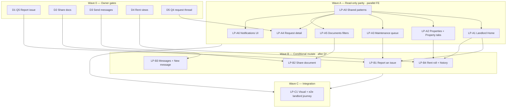

# Landlord Pages multi-agent plan (Figma `001 - Landlord Pages`)

**Status:** Proposed staffing plan — not yet owner-approved to reopen **WS-M**.  
**Figma:** [LG — Foundation (tokens + chrome) — Copy](https://www.figma.com/design/dJD89JgGDU1XFLvsR6g9km/LG-%E2%80%94-Foundation--tokens---chrome---Copy-?node-id=2036-467) · page `2036:467` · **001 - Landlord Pages**  
**Base:** `staging` (preferred) or current default after merge.  
**Related:** Phase 0 chrome done ([#57](https://github.com/CharmZoned/Maintenance-App-Portal/pull/57)); thin landlord shell + docs list ([#24](https://github.com/CharmZoned/Maintenance-App-Portal/pull/24), [#59](https://github.com/CharmZoned/Maintenance-App-Portal/pull/59)); full landlord self-serve still **hold** as **WS-M** in [`parallel-work-plan.md`](./parallel-work-plan.md).

---

## Goal

Bring the landlord portal to visual + behavioral parity with Figma **001 - Landlord Pages** (LH / LP / LPD / LM / LRQ / LRI / LMS / LNM / LD / LSD / LR / LRH / LN), without regressing staff/admin shells or LGA-18/19 ACL lockdown.

This plan is **not** “create/edit properties/units” (classic WS-M portfolio mutate). It is screen parity for the landlord journey board. Mutating capabilities that the Figma board assumes (report issue, share doc, send message, rent views) need explicit owner gates below.

---

## Current state (short)

| Family | Code today | Gap vs Figma |
|---|---|---|
| LH Home | Partial | KPIs, attention feed, rent strip, CTAs |
| LP Properties | Partial | Open-request counts, unread dots, L/E/Err frames |
| LPD Property | Partial | Tabs (Overview / Units / Requests / Messages / Documents / Rent); drop Market rent tile |
| LM Maintenance | Partial | Active/Closed vs Completed wording; Report CTA |
| LRQ Request | Near | Landlord chrome polish; Q4 conversation rules |
| LRI Report an issue | Missing | Needs Q5 + create ACL |
| LMS Messages | Partial | Composer read-only; unread filter; doc cards |
| LNM New message | Missing | Wizard + send path |
| LD Documents | Partial | All / Shared with me / I shared filters |
| LSD Share a document | Missing | Landlord upload ACL today staff-only |
| LR / LRH Rent | Missing | Route clamped away; UX brief Q1 may keep rent out |
| LN Notifications | Stub | Live push = **WS-L** hold; UI polish only here |

Primary nav already matches Figma (Home · Properties · Maintenance · Messages · Documents).

---

## Wave 0 — Owner decisions (blocking)

Do **not** staff Wave B until these are answered. Wave A can start immediately (read-only UI).

| ID | Question | If yes | If no | Default while waiting |
|---|---|---|---|---|
| **D1 / Q5** | Landlords can submit requests (“Report an issue”)? | Staff **LP-B1** (LRI + U10 landlord variant) | Omit CTAs; Home/Maintenance stay read-only create | **No create** (current code: `canCreateWorkOrders: isAdmin`) |
| **D2** | Landlords can share/upload documents? | Staff **LP-B2** (LSD) + ACL review vs LGA-19 | Keep staff-only upload; LD stays list/download | **Staff-only upload** |
| **D3** | Landlords can send messages / start threads? | Staff **LP-B3** (LMS send + LNM) | Keep composer read-only | **Read-only composer** |
| **D4 / Q1** | Show Rent roll + Payment history to landlords? | Staff **LP-B4**; allow `/rent` for landlord | Omit LR/LRH; no Home “View rent roll” | **Omit** (matches UX brief Q1 “hide rent”; Figma board still draws frames) |
| **D5 / Q4** | Landlord sees full tenant conversation on a request? | LRQ timeline shows tenant-visible thread | Status + landlord-own thread only | Keep current tenant_visible comments |

Also confirm: this plan does **not** reopen portfolio create/edit (properties/units/tenants writes). That stays classic **WS-M**.

---

## Dependency graph



---

## Parallel streams

### LP-A0 — Shared landlord patterns (serialize first, ~1 agent)

**Size:** S · **Conflict:** High on shared files · **Role:** FE  
**Owns:** document row, property card badges, section headers, empty/error/success notice reuse under `src/client/components/patterns/` and any shared landlord helpers.  
**DoD:** One PR; no screen rewrite yet; `/foundation` still green for existing specimens.

**Kickoff:**

```text
IMPLEMENT: LP-A0 from docs/landlord-pages-plan.md.
Extract/shared landlord list-row + property-card badge helpers needed by later Landlord Pages agents.
Figma file dJD89JgGDU1XFLvsR6g9km page 2036:467.
No ACL changes. No new routes. Prefer patterns/ + small pure helpers.
Branch cursor/<name>-4d73 off staging. PR into staging.
```

---

### LP-A1 — Landlord Home (LH)

**Size:** M · **Conflict:** `landlord-home-page.tsx` · **Deps:** A0 · **Role:** FE  
**Frames:** Default / All clear / Empty / Loading / Error / Success · Desktop + Phone (+ Tablet default).  
**DoD:** KPI/attention layout matches Figma; loading/empty/error; CTAs for Report / Message / View rent roll only if D1/D3/D4 yes (otherwise omit). Wire real open WO + portfolio data (no hardcoded “No new messages” if messages API exists).

**Kickoff:**

```text
IMPLEMENT: LP-A1 Landlord Home from docs/landlord-pages-plan.md.
Figma LH frames on page 2036:467 (file dJD89JgGDU1XFLvsR6g9km).
File: src/client/components/home/landlord-home-page.tsx.
Read-only unless owner D1/D3/D4 already decided yes — if undecided, omit mutate CTAs.
States: loading, empty, error, default. Branch + PR → staging.
```

---

### LP-A2 — Properties list + Property page (LP / LPD)

**Size:** L · **Conflict:** `properties-list.tsx`, `property-page.tsx`, property panels · **Deps:** A0 · **Role:** FE  
**DoD:** List cards show open-request count + unread affordance when data exists. Property page uses tabs: Units · Requests · Messages · Documents (± Overview / Rent if D4). Drop Market rent from summary tiles per UX brief U12. Loading / not-available / error frames.

**Kickoff:**

```text
IMPLEMENT: LP-A2 Properties + Property page from docs/landlord-pages-plan.md.
Figma LP + LPD frames, page 2036:467.
Tabbed property page; landlord remains non-editing for portfolio fields.
If D4 undecided/no, omit Rent tab. No landlord upload (that is LP-B2).
Branch + PR → staging.
```

---

### LP-A3 — Maintenance queue (LM)

**Size:** M · **Conflict:** `maintenance-page.tsx` (shared with staff/tenant — careful) · **Deps:** A0 · **Role:** FE  
**DoD:** Landlord queue matches Figma filters/states (default, loading, empty, filtered empty, error, completed/closed tab). Prefer role-scoped UI branches over rewriting staff path. No create button unless D1 yes.

**Kickoff:**

```text
IMPLEMENT: LP-A3 landlord Maintenance queue from docs/landlord-pages-plan.md.
Figma LM frames. Prefer landlord-specific presentation inside existing maintenance-page without breaking staff/tenant.
States + Completed/Closed tab parity. No Report CTA unless D1=yes.
Branch + PR → staging.
```

---

### LP-A4 — Request detail (LRQ)

**Size:** M · **Conflict:** `request-detail-page.tsx` · **Deps:** A0, D5 · **Role:** FE  
**DoD:** Desktop/Phone default, loading, not available, completed. Timeline/composer rules follow D5. Landlord stays non-staff (no internal notes, no status edits).

**Kickoff:**

```text
IMPLEMENT: LP-A4 landlord Request page from docs/landlord-pages-plan.md.
Figma LRQ frames. Honor D5/Q4 from the plan. No staff-note leak. Branch + PR → staging.
```

---

### LP-A5 — Documents filters (LD)

**Size:** M · **Conflict:** `landlord-documents-page.tsx` · **Deps:** A0 · **Role:** FE  
**DoD:** Filters All / Shared with me / I shared; property filter; grouped rows; loading/empty/error/filtered-empty/success. Download stays. No Share CTA unless D2 yes.

**Kickoff:**

```text
IMPLEMENT: LP-A5 landlord Documents from docs/landlord-pages-plan.md.
Figma LD frames. Filters + states. List/download only unless D2=yes. Branch + PR → staging.
```

---

### LP-A6 — Notifications panel UI (LN)

**Size:** S · **Conflict:** `notifications-panel.tsx`, bell · **Deps:** none · **Role:** FE  
**DoD:** Empty/default phone+desktop chrome matches Figma. Data may remain derived stub — **do not** implement R6/web push (**WS-L**). Label stub honestly if still synthetic.

**Kickoff:**

```text
IMPLEMENT: LP-A6 landlord Notifications UI polish from docs/landlord-pages-plan.md.
Figma LN frames only. No WS-L push/email. Branch + PR → staging.
```

---

### LP-B1 — Report an issue (LRI) — requires D1=yes

**Size:** M · **Conflict:** create WO path, `use-app-state.ts` ACL · **Deps:** D1, A1, A3 · **Role:** FE + light BE/RLS review  
**DoD:** Form frames (default/filled/field error/submitting/success) desktop+phone. Landlord can INSERT maintenance request for owned units only; emulator/RLS tests prove tenant/staff isolation unchanged.

**Kickoff:**

```text
IMPLEMENT: LP-B1 Report an issue (Figma LRI) from docs/landlord-pages-plan.md.
Owner D1/Q5 = yes. Threat-model against LGA-19; landlord create only for owned units.
Add FE form + enable canCreateWorkOrders for approved landlords (scoped). Tests under emulator. Branch + PR → staging.
```

---

### LP-B2 — Share a document (LSD) — requires D2=yes

**Size:** M · **Conflict:** documents upload, storage policies · **Deps:** D2, A5 · **Role:** FE + BE  
**DoD:** Share wizard frames; upload bound to owned property; visibility options match product wording; file-too-large + uploading + success. Migration if grants/policies needed — claim unique timestamp per [`ops/schema-migrations.md`](./ops/schema-migrations.md).

**Kickoff:**

```text
IMPLEMENT: LP-B2 Share a document (Figma LSD) from docs/landlord-pages-plan.md.
Owner D2 = yes. ACL: landlord upload on owned properties only; no staff-only visibility bypass.
Claim migration slot if needed. Emulator r5 tests. Branch + PR → staging.
```

---

### LP-B3 — Messages send + New message (LMS / LNM) — requires D3=yes

**Size:** L · **Conflict:** `messages-page.tsx`, `lib/messages.ts` · **Deps:** D3 · **Role:** FE (+ BE if DM model needed)  
**DoD:** Composer enabled for landlords; unread filter; send-failed; document cards in thread; LNM wizard steps. Direct DM vs WO-thread model must match existing schema — do not invent tables without product note in PR.

**Kickoff:**

```text
IMPLEMENT: LP-B3 landlord Messages + New message from docs/landlord-pages-plan.md.
Owner D3 = yes. Figma LMS + LNM. Prefer extending existing WO-comment threads; call out schema gaps instead of silent invention. Branch + PR → staging.
```

---

### LP-B4 — Rent roll + Payment history (LR / LRH) — requires D4=yes

**Size:** M · **Conflict:** `rent/*`, `safe-redirect.ts`, `portal-nav` (secondary links only) · **Deps:** D4, A1, A2 · **Role:** FE  
**DoD:** Landlord-safe read of rent roll + per-tenant payment history; route allowlist updated; still **not** in primary nav. RLS must already allow or be extended carefully.

**Kickoff:**

```text
IMPLEMENT: LP-B4 landlord Rent roll + Payment history from docs/landlord-pages-plan.md.
Owner D4 = yes (overrides UX Q1 hide-rent). Read-only. Secondary entry from Home + Property Rent tab. Update isLandlordAllowedRoute. Branch + PR → staging.
```

---

### LP-C1 — Integration QA

**Size:** M · **Deps:** Wave A (+ Wave B items that were staffed) · **Role:** QA / FE  
**DoD:** Manual matrix vs Figma desktop+phone defaults; browser e2e smoke for landlord shell; checklist in PR; capture artifacts under `/opt/cursor/artifacts` when run in Cloud Agent.

**Kickoff:**

```text
VERIFY: LP-C1 from docs/landlord-pages-plan.md.
Compare staging landlord journey to Figma 001 - Landlord Pages (2036:467).
Only flag in-scope gaps for staffed streams. Attach screenshots. File follow-up issues, do not expand scope.
```

---

## Conflict matrix (do not dual-own)

| File / area | Owner stream |
|---|---|
| `patterns/*`, shared doc row helpers | **LP-A0** then freeze |
| `home/landlord-home-page.tsx` | **LP-A1** |
| `properties/properties-list.tsx`, `property-page.tsx`, property panels | **LP-A2** |
| Landlord branch of `maintenance/maintenance-page.tsx` | **LP-A3** (coordinate if B1 adds CTA) |
| `maintenance/request-detail-page.tsx` | **LP-A4** |
| `documents/landlord-documents-page.tsx` | **LP-A5** → **LP-B2** after merge |
| `notifications-*` | **LP-A6** |
| `use-app-state.ts` create/upload flags | **LP-B1** / **LP-B2** only (serialize) |
| `messages/*` | **LP-B3** |
| `rent/*`, `safe-redirect.ts` landlord allowlist | **LP-B4** |
| `styles.css` token changes | Avoid; Phase 0 tokens already landed. File a note if a token is missing |

---

## Suggested staffing

| Phase | Agents in parallel | Gate |
|---|---|---|
| Day 0 | Owner answers D1–D5 | Unblocks Wave B scope |
| Then | 1× **LP-A0** | Merge before screen agents |
| Then | Up to 5× **LP-A1…A5** (+ A6 anytime) | Merge independently after A0 |
| Then | 0–4× **LP-B*** per yes decisions | Serialize ACL touchers B1→B2 if both need `use-app-state` |
| Finally | 1× **LP-C1** | Sign-off |

Max useful concurrency after A0: **6 FE agents** (A1–A6). With B streams, keep ACL PRs to **one at a time**.

---

## Out of scope (explicit)

- Classic **WS-M** portfolio mutate (create/edit properties, units, landlords)
- **WS-L** R6 web push / email delivery
- Admin / tenant / worker Figma pages
- Replacing Phase 0 chrome (`PortalNav` geometry) unless a Landlord Pages frame proves a defect
- Dark-mode Figma audit (not done on design pages either)

---

## Acceptance for “Landlord Pages done”

1. Every staffed Figma family has desktop + phone default implemented (plus loading/empty/error where the board shows them).  
2. Nav + route allowlist match product decisions D1–D4.  
3. No landlord write path exists unless its D* was yes and covered by emulator tests.  
4. LP-C1 checklist signed; residual gaps listed as follow-ups, not silent omissions.
