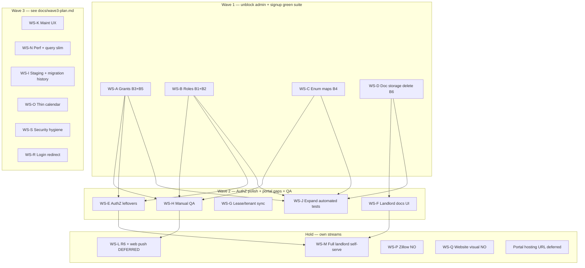

# Parallel work plan — remaining MVP + R1–R5 bugs

**Mode:** Historical stream definitions + Wave 1–2 context. **Wave 3 staffing:** **approved** — use [`docs/wave3-plan.md`](./wave3-plan.md) (pointer) and the Cursor Project store `docs/wave3-plan.md` (canonical: I/K/N/O + WS-S hygiene + WS-R; **P/Q + portal hosting/URL not staffed**). Implementers launched for **I / K / N / O / R / S1**.  
**Base (original):** `master` @ `15e0261` (merged [#18](https://github.com/CharmZoned/Maintenance-App-Portal/pull/18) test suite). **Wave 1–2 status:** merged on `master` (PRs #19–#29); no Wave 2 leftovers to re-plan.  
**Inputs:** gap analysis, `docs/deferred-work.md`, historical R1–R8 map in `docs/archive/IMPLEMENTATION_PLAN.pre-wave3.md`, role rundown, owner bug list (PR #18 intentional failures), live Supabase grants/CHECKs verified 2026-11-13; owner Wave 3 choices + hygiene 1–13 + hosting deferral (2026-11-14).  
**Product hold:** **R6 notifications + web push stays its own deferred stream (WS-L)** — do not staff until product reopens Phase 6.

---

## How to use this plan

1. For **Wave 3**, prefer kickoffs in [`docs/wave3-plan.md`](./wave3-plan.md) / Project store plan; stream definitions below remain authoritative for I/K/N/O/R/S.
2. Wave 1–2 historical context (bugs B1–B6, acceptance checkboxes) is retained below — those waves are **Done**; do not re-implement.
3. **Migration versions are scarce.** Before writing any `supabase/migrations/YYYYMMDDHHMMSS_*.sql`, scan `master` + all open `cursor/*` PR branches and claim a unique 14-digit prefix ≥ `20261114050000` (see [Migration number conflict avoidance](#migration-number-conflict-avoidance)).
4. Tag every item with source: **bug** (PR #18 / owner list), **gap** (gap analysis), **deferred** (`docs/deferred-work.md`), **req** (R1–R8), **hygiene** (Wave 3 S items).

---

## Verified bug causes (read-only; do not “fix” in this PR)

Confirmed against repo + live project `bgjkjtfgrfiszbzatriq`:

| ID | Symptom | Verified cause | Primary fix surface |
|----|---------|----------------|---------------------|
| **B1** (R1) | Unmatched email signup fails / no pending role | `private.handle_new_user` inserts `role=maintenance` with `staff_id NULL`; live `user_roles_subject_matches_role` requires `staff_id IS NOT NULL` for maintenance | Migration: constraint and/or trigger |
| **B2** (R2) | Admin reject/suspend fails (incl. no-role signup) | `set_account_status` always `INSERT (… maintenance, status) ON CONFLICT DO UPDATE` — Postgres checks the INSERT row against the constraint **before** conflict update, so reject/suspend of existing tenant/landlord/worker rows also fail | Migration: UPDATE-when-exists path; align with B1 for invent-row case |
| **B3** (R3) | Admin cannot create/edit landlords, properties, units, tenants | Live grants: those four tables are **SELECT-only** for `authenticated` (policies exist; privilege missing). `Leases` already has full DML grants | Migration: `GRANT INSERT, UPDATE, DELETE` (+ sequences) |
| **B4** (R3) | Form property types + unit Turnover/Unavailable rejected | App sends `single_family` etc. via `propertyToInsert`; live CHECK wants `Single-family`…. `unitStatusToDb` maps `turnover`→`Turnover`, `unavailable`→`Unavailable` but live `Units.status` CHECK is only `Occupied`\|`Vacant` | FE mappers (± UI or CHECK widen — product choice) |
| **B5** (R4) | Admin cannot delete work order | Live: `MaintenanceRequests` has SELECT/INSERT/UPDATE for `authenticated`, **no DELETE** | Migration: `GRANT DELETE` |
| **B6** (R5) | Delete document leaves storage object | `deletePropertyDocument` deletes the row **then** `storage.remove`. Storage **SELECT** policy joins `PropertyDocuments` by `storage_path`; after row delete, remove cannot see the object | FE: remove storage first (or adjust storage DELETE/SELECT). Confirm on real Storage |

**PR #18 note:** Intentional R1–R5 failures were cleared in Wave 1; R6 remains todos until WS-L. Do not weaken assertions. Required CI for `pnpm test` is a **WS-S S1 / owner** choice (Wave 1 no longer blocks it).

---

## Dependency graph / waves



| Wave | Streams (parallel OK) | Merge gate |
|------|----------------------|------------|
| **1** | A, B, C, D | **Done** — intentional `#18` reds for R1–R5 cleared (`pnpm test` emulator) |
| **2** | E, F, G, H, J | **Done** — AuthZ leftovers + landlord docs + lease sync + signed-off manual QA; test coverage expanded |
| **3** | I, K, N, O, S, R | See [`docs/wave3-plan.md`](./wave3-plan.md) — staging + migration history; Accept & schedule; perf; thin calendar; security hygiene; login redirect. **P/Q + portal hosting/URL not staffed** |
| **Hold** | L (R6 + web push), M (landlord MVP), P, Q, portal hosting/URL | Explicit product reopen / owner link only |

**Suggested merge order inside Wave 1:** A → B → C/D (A/B are independent migrations; merge either first; C is FE-only; D is FE-only). If two BE agents run together, **pre-claim migration timestamps** below.

---

## Migration number conflict avoidance

Latest repo prefixes on `master` (as of Wave 2 merge / `33424b7`):

- `20261114030000_harden_landlord_helpers_and_mr_notes.sql` (**WS-E**, merged)
- `20261114040000_property_documents_storage_path_bind.sql` (**WS-E**, merged)

**Wave 1–2 slots (merged — do not reuse):**

| Slot | Owner stream | Status |
|------|--------------|--------|
| `20261114010000` | **WS-A** Grants | **Merged** |
| `20261114020000` | **WS-B** Roles | **Merged** |
| `20261114030000` | **WS-E** AuthZ | **Merged** |
| `20261114040000` | **WS-E** storage path bind | **Merged** |
| `20261114050000+` | Wave 3 **WS-S S2** (or other schema need) | claim before writing; I/K/N/O/R prefer no DDL |
| `20261114100000+` | **WS-L** when reopened | leave free until Phase 6 |

Rules (also `docs/ops/schema-migrations.md`):

1. Never reuse a prefix on `master` or any open PR.
2. File migration in repo → PR → then apply live **with matching version**, or after an MCP clock stamp run `supabase migration repair --remote --yes` **reverted (clock) + applied (repo prefix)** back-to-back (never `db push` between). True duplicates: revert-only. See `docs/ops/schema-migrations.md`.
3. One logical concern per migration file when parallel agents are shipping; do not edit another stream’s migration.
4. Emulator auto-replays every file under `supabase/migrations/` — a bad migration fails `#18` by name.

---

## Workstreams

### WS-A — Portfolio + WO DELETE grants  
**Goal:** Restore admin/staff DML that RLS already allows but Postgres privileges block.  
**Size:** S · **Conflict risk:** Low (new migration only; no FE) · **Deps:** None  
**Agent role:** BE

| Item | Source | Notes |
|------|--------|-------|
| GRANT INSERT/UPDATE/DELETE on `Landlords`, `Properties`, `Units`, `Tenants` (+ USAGE/SELECT on identity sequences) | **bug B3** · **req R3** · **req R7** | Live verified SELECT-only |
| GRANT DELETE on `MaintenanceRequests` | **bug B5** · **req R4** | Live has SELECT/INSERT/UPDATE only |
| Confirm `Leases` / `PropertyDocuments` already granted (no-op) | **bug** context | Avoid duplicate GRANT noise |

**Files/areas:** `supabase/migrations/20261114010000_*.sql`; optionally note in `docs/ops/live-maintenance-acl-baseline.md` / `docs/supabase-schema.md`.  
**Acceptance:**

- [ ] Admin persona can create/update/delete landlord, property, unit, tenant via `src/client/lib/data.ts` under emulator (`tests/requirements/r3-*.test.ts` greens for writes).
- [ ] Admin can delete a work order (`r4` “admin deletes a work order” green).
- [ ] Non-admin still denied by RLS (r7 samples still pass).
- [ ] Migration version unique; applied to live only after PR with matching version/repair.

**Kickoff prompt:**

```text
PLAN→IMPLEMENT: WS-A from docs/parallel-work-plan.md (Wave 1).
Fix authenticated GRANTs only — no UI, no constraint changes.
Bugs B3+B5 (PR #18 intentional failures): Landlords/Properties/Units/Tenants need INSERT/UPDATE/DELETE; MaintenanceRequests needs DELETE. Verify against live grants first; write supabase/migrations/20261114010000_* (or next free slot if taken). Follow docs/ops/schema-migrations.md. Do not touch user_roles, mappers, or document delete. Branch cursor/<topic>-NNNN. Acceptance: r3 write tests + r4 admin delete WO pass under pnpm test; RLS denials still pass. Open PR; do not weaken tests.
```

---

### WS-B — Signup + reject/suspend (`user_roles` + RPCs)  
**Goal:** Public unmatched signup creates a pending queue row; admin reject/suspend works for all account shapes.  
**Size:** M · **Conflict risk:** Medium (rewrites `handle_new_user` / `set_account_status` also owned historically by Phase 2/3/LGA-18) · **Deps:** None for start; coordinate migration slot with A  
**Agent role:** BE (+ tiny FE only if error copy needs update)

| Item | Source | Notes |
|------|--------|-------|
| Allow pending unlinked maintenance **or** equivalent queue row | **bug B1** · **req R1** · **gap R1** | Constraint today forbids `maintenance` without `staff_id` |
| Rewrite `set_account_status` non-approve path: UPDATE if row exists; INSERT only when missing and valid | **bug B2** · **req R2** | PG evaluates INSERT CHECK before ON CONFLICT |
| Keep approve gates (admin / maint+staff / tenant+tenant / landlord+landlord) from LGA-18 | **req R2** · **deferred** LGA-18 QA | Do not regress approve invent rules |
| Ambiguous multi-match signup still no row (manual admin assign) | **deferred** | Out of scope unless easy |

**Recommended approach (product-aligned with Phase 2):** relax `user_roles_subject_matches_role` to allow `maintenance AND staff_id IS NULL` **only when** `account_status IN ('pending','rejected','suspended')` (or always allow null staff for maintenance but keep approve RPC requiring staff_id). Prefer constraint + trigger/RPC consistency over inventing dummy Staff rows.

**Files/areas:** new migration replacing functions from `20261113200000_*` / `203000_*` / `210000_*` / `241000_*` latest definitions; `tests/requirements/r1-*.test.ts`, `r2-*.test.ts`, `tests/workflows/wf2-*.test.ts`.  
**Acceptance:**

- [ ] `stranger@…` signup creates pending `user_roles` row (r1 unmatched signup green).
- [ ] Admin reject/suspend of pending, tenant, worker, and no-role users succeeds (r2 + wf2 suspend green).
- [ ] Approve still blocked without proper link; unlink-while-approved rules intact.
- [ ] Emulator migrations apply cleanly.

**Kickoff prompt:**

```text
PLAN→IMPLEMENT: WS-B from docs/parallel-work-plan.md (Wave 1).
Fix B1+B2 only: user_roles_subject_matches_role vs handle_new_user unmatched insert, and set_account_status INSERT…ON CONFLICT reject/suspend path. Latest function bodies are in 20261113241000 (LGA-18) — replace via new migration 20261114020000_* (claim slot; do not edit old files). Preserve LGA-18 approve gates. No portfolio grants (WS-A), no mappers (WS-C). Prove with pnpm test focusing r1/r2/wf2. Branch + PR. Do not weaken intentional assertions.
```

---

### WS-C — Property type + unit status value mapping  
**Goal:** Every value offered in property/unit dialogs is accepted by live CHECKs (or removed from UI).  
**Size:** S · **Conflict risk:** Low–medium (`mappers.ts` / dialogs; avoid fighting other FE on same files) · **Deps:** None  
**Agent role:** FE (± BE only if product chooses to widen CHECKs)

| Item | Source | Notes |
|------|--------|-------|
| Map UI property types ↔ DB (`single_family` → `Single-family`, etc.) in `propertyToInsert` / update paths / `mapProperty` | **bug B4** · **req R3** | Live CHECK list includes Apartment building / Other |
| Resolve unit `turnover` / `unavailable` | **bug B4** · **req R3** | Live `Units.status` is **only** Occupied\|Vacant. Options: (1) drop from UI, (2) map into `readiness_status`, (3) widen CHECK via migration — **ask owner if unclear; default = map Occupied/Vacant only + use readiness for turnover** |
| Align unit tests in `tests/unit/mappers.test.ts` + r3 value tests | **bug** / **#18** | |

**Files/areas:** `src/client/lib/mappers.ts`, `data.ts` property update, `property-dialog.tsx`, `unit-dialog.tsx`, `types.ts` if status union changes.  
**Acceptance:**

- [ ] r3 “app and database agree on allowed values” greens for every remaining form option.
- [ ] Creating/editing property+unit in emulator with each offered value succeeds.
- [ ] No CHECK widen on live unless product explicitly chose option 3.

**Kickoff prompt:**

```text
IMPLEMENT: WS-C from docs/parallel-work-plan.md (Wave 1).
FE-only preferred. Fix B4: propertyToInsert sends snake_case but DB wants Title-Case property_type; unitStatusToDb emits Turnover/Unavailable but live Units.status CHECK is Occupied|Vacant only. Prefer mapping + UI alignment (use readiness_status for turnover if needed) over widening CHECK unless owner already decided. Touch mappers/dialogs/types; no supabase grants/roles migrations. Make r3 enum tests + unit mapper tests pass. Branch + PR.
```

---

### WS-D — Property document storage delete  
**Goal:** Deleting a document removes both the row and the storage object.  
**Size:** S · **Conflict risk:** Low (`data.ts` delete helper) · **Deps:** None  
**Agent role:** FE (optional BE if storage policy must change)

| Item | Source | Notes |
|------|--------|-------|
| Reorder `deletePropertyDocument`: storage `remove` **before** row delete (while SELECT policy still finds the row) | **bug B6** · **req R5** · **gap R5** | Confirmed order in `data.ts` |
| On storage failure, do not leave orphan row (or compensate) | **bug B6** | |
| Optional later: bind storage UPDATE/DELETE to `storage_path` | **deferred** | Prefer WS-E/follow-up, not block D |

**Files/areas:** `src/client/lib/data.ts` (`deletePropertyDocument`); `tests/requirements/r5-*.test.ts`; storage policies in `20261113230000_*` (read-only unless needed).  
**Acceptance:**

- [ ] After delete, no `PropertyDocuments` row and no storage object at path (r5 / dedicated assertion green).
- [ ] Tenant/landlord still cannot delete (r5 deny tests).

**Kickoff prompt:**

```text
IMPLEMENT: WS-D from docs/parallel-work-plan.md (Wave 1).
Fix B6 only: deletePropertyDocument deletes DB row before storage.remove; storage SELECT policy requires PropertyDocuments row, so file remains. Reverse order (and handle errors). Confirm against emulator r5 tests; note live Storage confirm in PR. No MIME allowlist / landlord docs UI (those are other streams). Branch + PR.
```

---

### WS-E — AuthZ leftovers (R7)  
**Goal:** Close deferred permission polish before trusting landlord/prod multi-staff.  
**Size:** M · **Conflict risk:** Medium (helpers used by many policies; migration churn) · **Deps:** Prefer after Wave 1 A/B merged  
**Agent role:** BE (+ FE if landlord MR list must stop selecting `notes`)

| Item | Source | Notes |
|------|--------|-------|
| Route remaining `landlord_owns_*` through hardened `current_landlord_id()` | **deferred** · **gap R7** · **req R7** | |
| Hide `MaintenanceRequests.notes` from landlords (view/RPC or column split — not UI-only) | **deferred** · **gap R7** | RLS is row-level |
| Bind storage UPDATE/DELETE to existing `PropertyDocuments.storage_path` | **deferred** · **gap R5** | |
| Optional: service-role Payments trigger guard | **deferred** | Separate commit if large |
| Codify live-only `can_upload_maintenance_photo` into repo migrations | **deferred** | Schema drift |

**Files/areas:** new migrations `20261114030000` / `40000`; policies on MR/docs/storage; maybe `data.ts` select lists.  
**Acceptance:**

- [ ] Landlord JWT cannot read `notes` via PostgREST.
- [ ] Pending/re-roled user cannot use stale `landlord_id` through helpers under test.
- [ ] Storage update/delete cannot target arbitrary paths.
- [ ] r7 suite still green; add targeted tests if missing.

**Kickoff prompt:**

```text
IMPLEMENT: WS-E from docs/parallel-work-plan.md (Wave 2). Base on master after Wave 1 merges.
AuthZ leftovers only from docs/deferred-work.md + gap R7: landlord_owns_* → current_landlord_id(); strip landlord access to MaintenanceRequests.notes; bind property-documents storage UPDATE/DELETE to storage_path; optionally codify can_upload_maintenance_photo. Claim migration slots 20261114030000+. No R6. No full landlord self-serve. Tests via emulator. Branch + PR; follow schema-migrations.md for live apply.
```

---

### WS-F — Landlord documents UI (complete R5 portal surface)  
**Goal:** Landlord thin shell can list/download landlord-visible (and policy-allowed) docs.  
**Size:** S–M · **Conflict risk:** Medium (`app.tsx` nav, new page) · **Deps:** RLS already allows; better after D; independent of A/B  
**Agent role:** FE

| Item | Source | Notes |
|------|--------|-------|
| Landlord Documents nav + page (list/download only) | **gap R5** · **gap R8** · **deferred** · **req R5** | Shell today: Properties + Maintenance only |
| Reuse signed URL download patterns from tenant docs | **gap** | |
| Do **not** build full landlord portfolio mutate | **deferred** / **WS-M** | |

**Files/areas:** `src/client/app.tsx` (`LANDLORD_NAV`), new `components/documents/*` or landlord variant, `data.ts` list helpers if needed.  
**Acceptance:**

- [ ] Approved linked landlord sees landlord/tenant-visible docs for owned properties; not staff-only.
- [ ] Download works; upload/delete still denied.
- [ ] Typecheck/build clean.

**Kickoff prompt:**

```text
IMPLEMENT: WS-F from docs/parallel-work-plan.md (Wave 2).
Add landlord documents list/download UI on the existing thin landlord shell (RLS already ready). Sources: gap R5/R8 + deferred-work “Landlord documents UI”. Read role-capability-rundown for landlord limits. No portfolio create/edit (WS-M). No notifications. Prefer reuse of tenant docs patterns. Branch + PR; add/extend tests if straightforward under emulator.
```

---

### WS-G — Lease ↔ tenant ↔ unit link sync  
**Goal:** `Tenants.unit_id` / `LeaseTenants` stay consistent on lease update/delete (create already syncs).  
**Size:** S · **Conflict risk:** Medium (`data.ts` lease helpers) · **Deps:** Wave 1 A helpful so admin can exercise CRUD  
**Agent role:** FE

| Item | Source | Notes |
|------|--------|-------|
| `updateLease` / `deleteLease` sync `Tenants.unit_id` + `LeaseTenants` | **gap R3** | Create path already upserts |
| Optional: unit picker on tenant dialog | **gap R3** | Nice-to-have; keep S if skipped |

**Files/areas:** `src/client/lib/data.ts`, leases/tenants dialogs.  
**Acceptance:**

- [ ] Changing lease unit/primary tenant updates tenant.unit_id and membership rows.
- [ ] Deleting lease clears or reassigns tenant.unit_id per product rule (document choice in PR).
- [ ] No orphan `LeaseTenants`.

**Kickoff prompt:**

```text
IMPLEMENT: WS-G from docs/parallel-work-plan.md (Wave 2).
Fix lease/tenant/unit sync gap: createLease syncs Tenants.unit_id + LeaseTenants; updateLease/deleteLease do not. FE/data.ts only unless a small RPC is clearly safer. Tag gap R3. No grants/enums (Wave 1). Branch + PR with tests if feasible.
```

---

### WS-H — Manual QA (Phase 2 + LGA-18)  
**Goal:** Sign off live account approval and landlord/tenant link gates.  
**Size:** S · **Conflict risk:** None (no code) · **Deps:** Wave 1 B (and ideally A/C) merged + applied live  
**Agent role:** QA / human admin session

| Item | Source | Notes |
|------|--------|-------|
| Signup → verify → pending → Approve (with Staff/Tenant/Landlord link) / Reject / Suspend | **deferred** · **gap R2** · **req R2** | |
| LGA-18: approve tenant+link, landlord+link; block unlinked; block clear-link while approved | **deferred** · **gap R2/R3** | |
| Spot-check B3–B6 on live after Wave 1 apply | **bug** | |

**Acceptance:** Checklist results recorded (store `internal/` or PR comment); blockers filed back into deferred-work.

**Kickoff prompt:**

```text
QA ONLY: WS-H from docs/parallel-work-plan.md. No feature code.
Run manual Phase 2 + LGA-18 approve/link matrix on live Landlord Gopher after Wave 1 migrations are applied. Also smoke B3–B6 (portfolio write, enums, WO delete, doc storage delete). Write results to the Project store internal/ qa note. Update docs/deferred-work.md only to mark QA rows done if fully signed off.
```

---

### WS-I — Staging Supabase + migration version / history repair  
**Goal:** Safer schema workflow only — staging DB + migration-history cleanup (hygiene **#8**).  
**Size:** S–M · **Conflict risk:** Low–medium vs WS-S only on history/staging docs · **Deps:** None  
**Agent role:** Ops / BE docs  
**Hygiene:** owner item **#8** only. **#13** hosting/deploy + portal URL are **out of Wave 3** (deferred until owner provides the link).

| Item | Source | Notes |
|------|--------|-------|
| Supabase staging + **duplicate migration history cleanup** / version repair | **hygiene #8** · **deferred** | See ops SoT: [`docs/ops/schema-migrations.md`](./ops/schema-migrations.md) § Staging recommendation + §E. No live-only DDL. |

**Out of scope for WS-I:** portal hosting/deploy config; portal URL; website `NEXT_PUBLIC_PORTAL_URL` / login-link wiring; WordPress retirement / Next.js launch — see deferred-work **“Portal hosting + URL: deferred until owner provides the link”**.

**Acceptance (split):**
- **Docs / proposal (done on PR #31):** staging re-parked with cost note; mismatch inventory + repair plan in ops doc; no hosting/URL claimed as WS-I.
- **Remaining (live ops):** owner confirms staging cost → create `staging`; ops go-ahead → run §E repair; then clear deferred-work rows.

**Kickoff prompt:**

```text
OPS: WS-I from docs/wave3-plan.md / parallel-work-plan. Staging + migration history only.
Propose staging only until owner confirms ~$0.01344/hr; then create. Migration history cleanup per schema-migrations.md (§E). Never live-only DDL. Do NOT deploy portal, invent a host, or set NEXT_PUBLIC_PORTAL_URL. Coordinate with WS-S if both touch history repair.
```

---

### WS-J — Expand automated tests (harness exists post-#18)  
**Goal:** Turn deferred “when vitest/pgTAP lands” items into real suites now that the emulator exists.  
**Size:** M · **Conflict risk:** Low–medium (tests only; avoid fighting Wave 1 on same requirement files mid-fix) · **Deps:** Best after Wave 1 greens  
**Agent role:** QA/BE

| Item | Source | Notes |
|------|--------|-------|
| Payment ledger RPC tests | **deferred** · **req R7** | |
| Tenant photo isolation + status history append-only | **deferred** · **req R4** | |
| Document visibility isolation | **deferred** · **req R5** | |
| Optional: mark remaining product gaps without using `test.fails` that hide regressions | **#18 follow-up** | |

**Files/areas:** `tests/requirements/*`, `tests/workflows/*`; do not change app except tiny test seams if unavoidable.  
**Acceptance:** New tests pass on emulator; documented in `tests/README.md`.

**Kickoff prompt:**

```text
IMPLEMENT TESTS: WS-J from docs/parallel-work-plan.md (Wave 2).
Harness from PR #18 is on master. Add deferred automated coverage: payment RPC ledger tests; maintenance photo isolation + append-only history; property document visibility isolation. Prefer new tests over changing app. Wait until Wave 1 bugfix PRs merged so baseline is green. No R6 implementation (todos stay until WS-L). Branch + PR.
```

---

### WS-K — Maintenance Accept & schedule UX  
**Goal:** Faster admin intake (assign + calendar in one action); optional dialog split.  
**Size:** M · **Conflict risk:** High on `work-order-dialog.tsx` · **Deps:** None functionally; schedule after Wave 1 to avoid thrash  
**Agent role:** FE

| Item | Source | Notes |
|------|--------|-------|
| Richer Accept & schedule UX | **deferred** · **gap R4** · **req R4** | Admin-only already gated |
| Split work-order-dialog panels | **deferred** | Maintainability |

**Acceptance:** Admin can assign staff + schedule in one confirmed flow; tenant/staff permissions unchanged; typecheck/build green.

**Kickoff prompt:**

```text
IMPLEMENT: WS-K from docs/parallel-work-plan.md (Wave 3).
Maintenance UX polish only: richer Accept & schedule (assign + date) and optional work-order-dialog split. Do not change RLS/grants. No R6 emails. Coordinate if other PRs touch work-order-dialog.tsx. Branch + PR.
```

---

### WS-L — R6 Notifications + web push (**own stream — DEFERRED**)  
**Goal:** When product reopens Phase 6: staff email/push/message center (includes owner hygiene **#12** web push).  
**Size:** L · **Conflict risk:** N/A while held · **Deps:** Product decision; prefer after Wave 1–2 stable  
**Agent role:** BE (Edge Functions) + FE

| Item | Source | Notes |
|------|--------|-------|
| Entire Phase 6 | **req R6** · **deferred** · **gap R6** · `#18` 10 todos | `Staff.gets_request_alerts` unused |
| Web push | **hygiene #12** | Held here — do not staff under Wave 3 WS-S |
| Keep interim toasts/banners | **req R6** decision | Do not replace with email until reopened |

**Do not schedule agents** until explicitly reopened. When reopened, convert `tests/requirements/r6-notifications.test.ts` todos into real tests.

**Kickoff prompt (only after product reopen):**

```text
IMPLEMENT: WS-L / Phase 6 from docs/parallel-work-plan.md + docs/phases/phase-6.md.
Product has reopened R6. Build notifications per phase-6 DoD (start with staff email on MR insert/status using gets_request_alerts). New migrations in a fresh timestamp range (≥20261114100000 or later free). Implement Edge Functions under supabase/functions. Expand r6 tests (replace todos). No scope creep into landlord self-serve.
```

---

### WS-M — Full landlord self-serve (hold)  
**Goal:** Landlords create/edit own portfolio beyond read-only shell.  
**Size:** L · **Conflict risk:** High (ACL policies from LGA-18/19) · **Deps:** E + F + product scope  
**Agent role:** BE + FE

| Item | Source | Notes |
|------|--------|-------|
| Landlord mutate portfolio | **deferred** · **gap R3/R8** · **req R3** | Currently admin-only writes |

**Kickoff:** Only after product scopes landlord MVP; start with threat model vs LGA-19 write lockdown.

---

### WS-N — Perf / query slim / docs polish  
**Goal:** Non-blocking performance and docs UX polish.  
**Size:** S–M (bundle of S items) · **Conflict risk:** Low–medium · **Deps:** None  
**Agent role:** FE

| Item | Source | Notes |
|------|--------|-------|
| Dashboard/charges N+1 | **deferred** | |
| Slim Users / Applications queries; paginate Users RPC; paginate docs >200 | **deferred** | |
| Shared `formatBytes` / doc row; staff title edit after visibility widen; MIME allowlist | **deferred** · **gap R5** | |
| Soft-fail `generateCharges` toast; Phase 1.5 medium payment polish | **deferred** | |

**Kickoff prompt:**

```text
IMPLEMENT: WS-N from docs/parallel-work-plan.md (Wave 3).
Pick a small coherent subset of deferred perf/docs polish (not all at once). No schema AuthZ redesign (WS-E). No R6. Keep PRs small. Branch + PR.
```

---

### WS-O — Thin read-only property calendar (roadmap #9 skinny) — **YES staff Wave 3**  
**Goal:** Staff/admin month view of existing dates only.  
**Size:** M · **Conflict risk:** Medium (nav + aggregators) · **Deps:** Prefer after WS-K  
**Agent role:** FE

| Item | Source | Notes |
|------|--------|-------|
| Month view: WO `scheduled_at` / `next_follow_up_date`, lease start/end, rent `due_date`, optional application `desired_move_in` | **deferred** · roadmap **#9** | Click → existing detail pages |
| No create/drag/recurrence | product | Full calendar stays out of Wave 3 |

**Acceptance:** Read-only month view; navigation works; typecheck/build green. Fetches are **date-windowed** and **slim-select** (no full `listWorkOrders` / `listLeases` / charges enrich for the whole portfolio); no per-event N+1; do not re-pull staff notes on every list.

**Kickoff prompt:**

```text
IMPLEMENT: WS-O from docs/wave3-plan.md (Wave 3). Thin read-only calendar only. Prefer after WS-K. Date-window + slim queries only — no unbounded list enrich / N+1. No R6, no landlord mutate, no recurrence. Branch + PR.
```

---

### WS-P — Zillow sync research (roadmap #10) — **NO / not staffed**  
Owner chose **not** to staff in Wave 3. Remains in `docs/deferred-work.md`.

---

### WS-Q — Website visual revisions (roadmap #11) — **NO / not staffed**  
Owner chose **not** to staff in Wave 3. Remains in `docs/deferred-work.md`.

---

### WS-R — Login `?redirect=` (Phase 4b / hygiene #9)  
**Goal:** Safe post-login redirect for website → portal CTAs.  
**Size:** S · **Conflict risk:** Low (auth routing) · **Deps:** None (production portal URL is deferred)  
**Agent role:** FE

**Acceptance:** After login, honor `?redirect=` only for same-origin **path** values starting with `/` (no `//`, no `http:`, `https:`, `javascript:`, or other schemes). Prefer in-app navigation over raw `location.assign` to external URLs. Reject open redirects; add tests for malicious values; document behavior.

**Kickoff prompt:**

```text
IMPLEMENT: WS-R from docs/wave3-plan.md (hygiene #9). Portal FE login ?redirect= only. Allow path-only same-origin redirects; reject //, absolute URLs, and non-http schemes. Prefer in-app nav. No RLS. Do not wire production hosting/URL (deferred). Branch + PR.
```

---

### WS-S — Security and hygiene (owner items 1–13)  
**Goal:** CI/repo hygiene first, then AuthZ/security migrations, then password policy. Ship as **lanes**, not one mega-PR.  
**Size:** L program · **Conflict risk:** High among S2 migrations · **Deps:** None for S1  
**Agent role:** Ops + BE + light FE  
**Canonical detail:** Project store `docs/wave3-plan.md` § hygiene table.

| Lane | Items | Effort | Parallel with I/K/N/O? |
|------|-------|--------|------------------------|
| **S1** Repo/CI | **#1** required CI checks; **#2** archive D1/Hono/Clawnify + refresh IMPLEMENTATION_PLAN + retire `main`/`sync-branches` (owner confirm) | S + M | **Yes** |
| **S2** AuthZ mig (serialize; order **3→10→5→4→6**) | **#3** revoke anon (+ PUBLIC if needed) EXECUTE on payment RPCs; keep authenticated GRANT; verify privileges; **#10** Settings admin-only; **#5** `email_confirmed_at` on approve; **#4** last-admin guard; **#6** 5-photo DB cap | S–M each | **No** other migration/RLS PRs |
| **S3** Auth policy | **#7** leaked-password + min length | S | **Yes** (Auth dashboard + auth forms) |
| → **WS-I** | **#8** migration history + staging | — | See WS-I |
| → **WS-R** | **#9** `?redirect=` | — | See WS-R |
| Owner then FE | **#11** status labels | S after decision | Avoid during WS-K mega-edit |
| → **WS-L** | **#12** web push | — | Hold |
| → **deferred-work** | **#13** hosting/deploy + portal URL + website env | — | Out of Wave 3 until owner provides the link |

**Acceptance (per item):** see Project store wave3-plan hygiene table. **Migrations only from repo files**; claim ≥ `20261114050000`.

**Kickoff prompt (S1):**

```text
IMPLEMENT: WS-S S1 from docs/wave3-plan.md. Items 1–2 only: required GitHub CI checks; archive D1/Hono/Clawnify primary-path claims; refresh IMPLEMENTATION_PLAN; retire main sync only if owner confirmed. No Supabase migrations. No R6.
```

**Kickoff prompt (S2):**

```text
IMPLEMENT: WS-S S2 from docs/wave3-plan.md. One migration PR at a time (prefer 3→10→5→4→6). Never live-only DDL. Emulator tests. Do not rewrite work-order-dialog (WS-K). No R6 / landlord self-serve.
```

---

## Conflict matrix (quick)

| | A | B | C | D | E | F | G | K |
|-|---|---|---|---|---|---|---|---|
| **A** grants mig | — | mig slots | | | after A | | wants A | |
| **B** roles mig | slots | — | | | touches status RPC | | | |
| **C** mappers | | | — | | | | | |
| **D** data delete | | | | — | storage policies | docs UX | data.ts | |
| **E** AuthZ | | status helpers | | storage | — | | | |
| **F** landlord nav | | | | | | — | | |
| **G** leases data | | | | data.ts | | | — | |
| **K** WO dialog | | | | | | | | — |

**Wave 3 addendum:** At most one PR rewriting `work-order-dialog.tsx` large structure (**WS-K**). At most **one open WS-S S2 migration/RLS PR** at a time. **WS-I** owns migration-history cleanup (#8) — do not dual-staff with S. **WS-O** prefers after K.

**Hard rule:** At most **one open PR** rewriting `set_account_status` / `handle_new_user` (WS-B — done). At most one PR rewriting `work-order-dialog.tsx` large structure (WS-K). `data.ts` lease helpers (G) vs document delete (D) can parallel if agents touch disjoint functions.

---

## Requirement coverage summary

| Req | Wave 1 bugs | Remaining gaps / deferred | Hold |
|-----|-------------|---------------------------|------|
| **R1** | B1 signup | Invite-only Auth; ambiguous email UX | — |
| **R2** | B2 reject/suspend | Manual QA (H) **done** | — |
| **R3** | B3 grants, B4 enums | Lease sync (G) **done**; full landlord MVP (M) | M |
| **R4** | B5 DELETE grant | Accept & schedule (K); thin calendar (O); 5-photo DB (S #6); tests (J done) | — |
| **R5** | B6 storage delete | Landlord docs (F done); MIME (N) | — |
| **R6** | — | — | **WS-L entire** (+ web push #12) |
| **R7** | grants part of A | WS-E done; payment tests (J done); S hygiene (#3–5, #10) | — |
| **R8** | unblocked by A–D | Login redirect (R); Phase 4 URL/hosting **deferred** until owner provides link | M |

---

## Out of scope for fix agents until owner asks

- Implementing any Wave stream in the **planning** PR that only adds this doc.
- Opening R6 / Phase 6 / web push work.
- Staffing **WS-P** / **WS-Q** (owner NO).
- Portal hosting/deploy, inventing a portal host, or wiring `NEXT_PUBLIC_PORTAL_URL` (deferred until owner provides the link).
- Live-only DDL without a repo migration file (see `docs/ops/schema-migrations.md`).
- Merging PRs (human only).

---

## Source index

| Doc | Path |
|-----|------|
| Wave 3 plan (pointer) | `docs/wave3-plan.md` |
| Wave 3 plan (canonical) | Project store `docs/wave3-plan.md` |
| Gap analysis | Project store `docs/gap-analysis-requirements.md` (and uploaded copy) |
| Deferred | `docs/deferred-work.md` |
| Plan / R1–R8 (historical) | `docs/archive/IMPLEMENTATION_PLAN.pre-wave3.md` (live pointer: `docs/IMPLEMENTATION_PLAN.md`) |
| Phase 6 hold | `docs/phases/phase-6.md` |
| Role rundown | Project store `docs/role-capability-rundown.md` |
| Migration ops | `docs/ops/schema-migrations.md` |
| Test harness | `tests/README.md`, PR [#18](https://github.com/CharmZoned/Maintenance-App-Portal/pull/18) |
