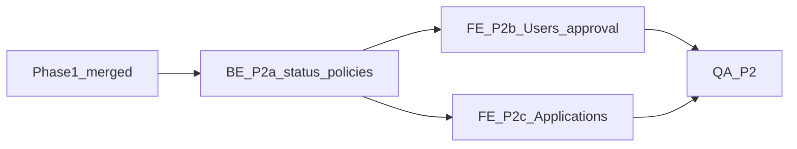

# Phase 2 — Account approval + Applications UI (R2, R8)

**Status:** Planning with locked product decisions (2026-11-13). Feature work starts after the Nov 9 maintenance port onto `master`.  
**Depends on:** Phase 1 Auth + `user_roles.account_status` + approved-only RLS helpers; port of `cursor/maintenance-work-orders-33a0`.  
**Out of scope here:** Tenant maintenance submit (Phase 3), website CTA (Phase 4), documents, notifications, messaging (Phase 2.5), full performance rewrite of `data.ts`.

**Locked for this phase**

- Signup → Supabase **email verification** → `account_status = pending` until **admin** approves
- **Only admin** may approve / reject / suspend accounts (not maintenance role)
- Related (Nov 9 port): **only admin** may OK / Accept & schedule maintenance orders

---

## Goal

Pending users cannot use the portal; **admins** can **approve / reject / suspend** accounts; rental **Applications** UI is clearly separate from account approval.

**DoD**

- [ ] Signup with email verification; verified users land in `account_status = pending`
- [ ] Pending / rejected / suspended cannot load portfolio data (UI + RLS already partially done in Phase 1 — keep hardened)
- [ ] Admin Users page can list users by status and change status (**admin-only**)
- [ ] Applications list/detail exists and is labeled as rental applicants (not the approval queue)
- [ ] QA checklist signed off

---

## Phase 1 leftovers (do before or in a small Phase 1 follow-up PR — not Phase 2 product)

From re-review `@ c6af01a` (`internal/phase1-rereview-c6af01a.md`):

| Priority | Item | Notes |
|----------|------|--------|
| High | Gate **all** portfolio mutate UI on `isAdmin` | Landlords/properties/tenants/leases/rent/vendors/settings still show CRUD to `maintenance` role; RLS denies — close UX/AuthZ gap |
| Must | Fix `lease-dialog.tsx` `useEffect([open, app])` | Same cancel + stable-callback pattern as payment/WO dialogs |
| Medium | Payment ledger RPC (record + delete) | Atomic `amount_paid` update; reduces RMW race |
| Medium | `FORCE ROW LEVEL SECURITY` on Phase 1 tables | Leases, LeaseTenants, RentCharges, Payments, Vendors, Settings |
| Medium | Narrow `vendors_select` for landlords | Currently any landlord |
| Should | Soft-fail bootstrap / `generateCharges` error swallowing | Surface failures |
| Perf | Dashboard / charges N+1 | Defer unless blocking; not Phase 2 DoD |

Track completion in Phase 1 PR or a tiny `cursor/phase1-followups-*` PR — **do not block** Phase 2 planning acceptance on these, but **do** fix High + lease-dialog before multi-staff production.

---

## What Phase 1 already delivered (reuse)

- Column `user_roles.account_status` (`pending|approved|rejected|suspended`), default `pending`
- `private.assign_admin` sets `approved`
- App gate: `unapproved` / `forbidden` / `error` / `ready`
- SQL: `current_role`, `current_*_id`, `is_admin`, `is_staff_or_admin` require `approved`
- Open D1 `/api` retired (410)

Phase 2 adds **admin UX + policies to change status** and **Applications screens**, plus signup → pending path.

---

## Dependency graph

---

## Agent packages

### P2a — BE: Status policies + admin update path

**Tasks**

- [ ] Admin-only policies (or SECURITY DEFINER RPC) to **update** `user_roles.account_status` (and optionally role/link ids)
- [ ] Ensure non-admins cannot self-approve
- [ ] Optional RPC `approve_user(user_id)` / `set_account_status(user_id, status)` with audit-friendly comments
- [ ] Confirm JWT hook / helpers still deny non-approved after status change until refresh (document client re-fetch)
- [ ] Applications: add **read** (and admin write if needed) RLS policies — table currently RLS-on, no policies
- [ ] Migration under `supabase/migrations/`; update `docs/supabase-schema.md`
- [ ] Do **not** break `inquiries` (website service-role)

**Acceptance:** Admin can change status via SQL/RPC; pending JWT still cannot SELECT portfolio rows; Applications selectable by admin.

**Handoff:** Column/RPC contract + typegen updates for FE.

### P2b — FE: Users / approval queue

**Tasks**

- [ ] Admin-only nav item **Users** (or Settings subsection)
- [ ] List Auth-linked rows from `user_roles` (+ email via safe view/RPC if needed — never expose service role in client)
- [ ] Filters: pending / approved / rejected / suspended
- [ ] Actions: Approve, Reject, Suspend (and optionally Re-approve)
- [ ] Signup path: if public signup enabled, land as `pending` with no portfolio access; copy explains wait for approval
- [ ] After approve, prompt user to refresh session / re-login so JWT + helpers pick up access

**Acceptance:** Admin can clear the pending queue; pending user still blocked until approved.

**Does not:** Build landlord/tenant self-serve portals.

### P2c — FE: Applications (rental applicants)

**Tasks**

- [ ] Nav/page **Applications** clearly labeled "Rental applications" (not account approval)
- [ ] List/detail for `Applications` table (status, unit, contact, notes)
- [ ] Staff/admin create/edit/update status as needed for Phase 2 scope
- [ ] Empty states; no confusion with Users page

**Acceptance:** Reviewer can tell Applications ≠ Users approval in under 5 seconds.

### P2d — QA

| # | Check | Expected |
|---|--------|----------|
| 1 | New signup / pending user | Blocked UI + empty/denied portfolio queries |
| 2 | Admin approves | User can reach portfolio after session refresh |
| 3 | Reject / suspend | Access revoked on next resolve / token refresh |
| 4 | Non-admin cannot change statuses | RPC/RLS deny |
| 5 | Applications page | Labeled; CRUD per policies; not mixed with Users |
| 6 | Website inquiries | Still works via service role |

Write results back into this file when done.

---

## Branch / PR recommendation

- Keep Phase 1 MVP on `cursor/phase0-phase1-mvp-8ed9` (user opens/merges via compare).
- Implement Phase 2 on `cursor/phase2-<topic>-8ed9` **after** Phase 1 merge (or stack on Phase 1 head).
- This planning doc PR: `cursor/phase2-planning-8ed9` → `master` (docs only).

---

## Open questions (non-blocking for writing the plan)

1. Public signup vs invite-only Auth for staff?
2. How to show Auth email in Users list without service role (DB view / Edge Function)?
3. Should landlords appear in the same Users queue or only staff/admin applicants?
