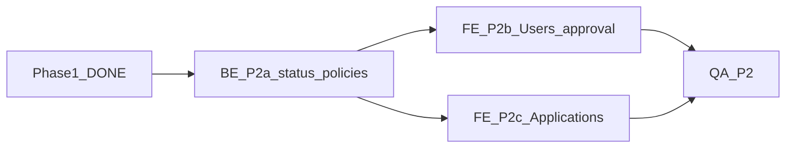

# Phase 2 — Account approval + Applications UI (R2, R8)

**Status:** Next product phase (planning ready). Phase 1.5 High/Must/Medium leftovers are done (see table); only Should/Perf remain.  
**Depends on:** Phase 1 Auth + `user_roles.account_status` + approved-only RLS helpers (**done** on `master`).  
**Out of scope here:** Tenant maintenance submit (Phase 3), website CTA (Phase 4), documents (Phase 5), email/push/messaging (Phase 6 **deferred** — use popups/toasts).

---

## Goal

Pending users cannot use the portal; admins can **approve / reject / suspend** accounts; rental **Applications** UI is clearly separate from account approval.

**DoD**

- [ ] Signup (or invite) lands in `account_status = pending` after email verification
- [ ] Pending / rejected / suspended cannot load portfolio data (UI + RLS — partially done in Phase 1)
- [ ] Admin Users page can list users by status and change status
- [ ] Applications list/detail exists and is labeled as rental applicants (not the approval queue)
- [ ] QA checklist signed off

---

## Phase 1 leftovers (Phase 1.5 — not Phase 2 product)

| Priority | Item | Notes |
|----------|------|--------|
| High | Gate **all** portfolio mutate UI on `isAdmin` | **Done** on `master` (`3fc7a64`) — `canMutatePortfolio` / hook guards |
| Must | Fix `lease-dialog.tsx` `useEffect([open, app])` | **Done** on `master` (`3fc7a64`) — cancel + stable callbacks |
| Medium | Payment ledger RPC (record + delete) | **Done** Phase 1.5 — `public.record_payment` / `delete_payment` |
| Medium | `FORCE ROW LEVEL SECURITY` on Phase 1 tables | **Done** Phase 1.5 — Leases, LeaseTenants, RentCharges, Payments, Vendors, Settings |
| Medium | Narrow `vendors_select` for landlords | **Done** Phase 1.5 — staff/admin only |
| Should | Soft-fail bootstrap / `generateCharges` error swallowing | Tracked in [`docs/deferred-work.md`](../deferred-work.md) |
| Perf | Dashboard / charges N+1 | Tracked in [`docs/deferred-work.md`](../deferred-work.md) |
| Should | Payment ledger / status RPC tests | Tracked in [`docs/deferred-work.md`](../deferred-work.md) |

Track as Cursor Project task **Phase 1.5** (**LGA-6**). High + lease-dialog + Medium items done; parked Should/Perf → [`deferred-work.md`](../deferred-work.md).

---

## What Phase 1 already delivered (reuse)

- Column `user_roles.account_status` (`pending|approved|rejected|suspended`), default `pending`
- `private.assign_admin` sets `approved`
- App gate: `unapproved` / `forbidden` / `error` / `ready`
- SQL helpers require `approved`
- Open D1 `/api` retired (410)

Phase 2 adds **admin UX + policies to change status** and **Applications screens**, plus signup → verify → pending.

---

## Dependency graph

---

## Agent packages

### P2a — BE: Status policies + admin update path

- [ ] Admin-only policies (or SECURITY DEFINER RPC) to update `user_roles.account_status`
- [ ] Ensure non-admins cannot self-approve
- [ ] Optional RPC `approve_user` / `set_account_status`
- [ ] Applications: add read (and admin write) RLS — table currently RLS-on, no policies
- [ ] Migration under `supabase/migrations/`; update `docs/supabase-schema.md`
- [ ] Do **not** break `inquiries`

**Acceptance:** Admin can change status via SQL/RPC; pending JWT cannot SELECT portfolio; Applications selectable by admin.

### P2b — FE: Users / approval queue

- [ ] Admin-only nav **Users**
- [ ] List `user_roles` (+ email via safe view/RPC — never service role in client)
- [ ] Filters: pending / approved / rejected / suspended
- [ ] Actions: Approve, Reject, Suspend (and optionally Re-approve) with confirm **popups**
- [ ] Signup → email verify → `pending`; copy explains wait for approval
- [ ] After approve, prompt refresh / re-login

**Acceptance:** Admin clears pending queue; pending user blocked until approved.

### P2c — FE: Applications (rental applicants)

- [ ] Nav/page **Applications** labeled "Rental applications"
- [ ] List/detail for `Applications` (status, unit, contact, notes)
- [ ] Staff/admin create/edit/update status
- [ ] Empty states; no confusion with Users page

### P2d — QA

| # | Check | Expected |
|---|--------|----------|
| 1 | New signup / pending user | Blocked UI + denied portfolio queries |
| 2 | Admin approves | User reaches portfolio after session refresh |
| 3 | Reject / suspend | Access revoked on next resolve |
| 4 | Non-admin cannot change statuses | RPC/RLS deny |
| 5 | Applications page | Labeled; not mixed with Users |
| 6 | Website inquiries | Still works via service role |

---

## Open questions (non-blocking)

1. Public signup vs invite-only Auth for staff?
2. How to show Auth email in Users list without service role?
3. Should landlords appear in the same Users queue or only staff/admin applicants?
