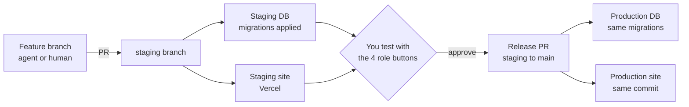

# Staging environment — design plan

**Status:** Approved by the owner · 2026-11-18 · build steps in [`BUILD_PLAN.md`](BUILD_PLAN.md)
**Scope:** A real staging environment (UI + database) with one-click role sign-in, and a
controlled path from staging to production for both the UI and the database.
**Decisions:** recorded as ADRs in [`docs/adr/`](../adr/README.md). All ten are
settled — see [Decisions needed](#decisions-needed).

Progress is tracked in [`BUILD_PLAN.md`](BUILD_PLAN.md). As of 2026-11-18, Phase 1 (repo
foundations) is built; no database or hosting change has been made yet.

---

## 1. What you asked for

1. A proper staging site backed by the staging database.
2. On the staging login page, four buttons — Admin, Landlord, Tenant, Maintenance — that
   drop you straight into that role's screen with no passwords to remember.
3. Make changes on staging, test and approve them, then push to production — UI and
   database together.

## 2. Where things stand today

Verified against the repo (`main` @ `90a0239`) and the live Supabase org on 2026-11-18.

| Area | Finding | Why it matters |
|---|---|---|
| UI hosting | **The portal is not deployed anywhere.** Hosting is parked in `docs/deferred-work.md` (roadmap #3). | "Push the UI to prod" has no target yet. This plan creates staging *and* production hosting. |
| Environments in code | The app reads only `VITE_SUPABASE_URL` and `VITE_SUPABASE_ANON_KEY`. It has no idea which environment it is in. | Needed for the staging banner and the one-click buttons. |
| Production DB | Supabase project `bgjkjtfgrfiszbzatriq`, Pro plan, GitHub integration on, production follows git `main`. All 59 repo migrations are recorded with matching versions. | The history repair described in `docs/ops/schema-migrations.md` §E appears to be done; that doc is stale. |
| Staging DB | A Supabase branch named `staging` **already exists** (`ffczsojnowxthntnliac`) but is broken: last run `MIGRATIONS_FAILED`, not persistent, not linked to a git branch. It is missing `inquiry_email_controls` and `visibility_helpers_require_approved` (a security migration), and records four migrations under different version numbers than the repo. It holds seven `phase4-*@example.test` accounts that have never signed in. | The docs say staging does not exist. It does, and it does not match production. See [ADR-0003](../adr/0003-staging-database.md). |
| Supabase config | There is **no `supabase/config.toml`** in the repo. | Auth settings — email confirmation, password rules, redirect addresses, the access-token hook — exist only as hand-made dashboard settings on production. A fresh environment does not get them, so staging would behave differently from production. (Correction, 2026-11-18: an earlier draft said RLS depends on the hook. It does not — the access rules look roles up in `user_roles`; the hook is kept for parity only.) |
| Edge Functions | Three functions in `supabase/functions/` (Stripe intent, Stripe webhook, receipt). **None are deployed** on production. | Fine while Stripe is on hold; staging needs test keys when that changes. |
| Git | The production branch (then named `master`, renamed `main` on 2026-11-19) is the default branch and receives every PR. A stale older `main` branch sits 42 commits behind. CI runs on PRs to the production branch only. | A `staging` branch needs CI and protection too. The stale `main` is a trap for agents. |
| Repo visibility | **The GitHub repo is public.** | No password, hash, or key may be committed — this shapes how demo logins are seeded. See [ADR-0010](../adr/0010-repository-visibility.md). |
| Local demo | `pnpm dev:local` already runs the portal on an in-process emulator with a seeded world and one login per role (`tests/emulator/seed.ts`). | The staging seed and the one-click buttons can reuse this instead of inventing a second demo world. |
| Shared DB | The marketing website repo writes to the same production database and has applied its own migrations there. | That is what caused the migration-history drift. See [ADR-0009](../adr/0009-schema-ownership.md). |

## 3. Target design

### 3.1 Environments

| | Local | Staging | Production |
|---|---|---|---|
| Git branch | any | `staging` (new default branch) | `main` |
| UI | `localhost:5198` via `pnpm dev:local` | Vercel, staging domain, behind a login gate | Vercel, production domain, public |
| Database | In-process emulator | Supabase persistent branch `staging` | Supabase `bgjkjtfgrfiszbzatriq` |
| Data | Seeded demo world | Seeded demo world, resettable | Real |
| One-click role sign-in | Yes | Yes | **Never** — not in the bundle, accounts do not exist |
| Deploys when | You run it | A PR merges into `staging` | The release PR merges into `main` |
| Stripe / email | None | Test keys, sandboxed mail | Live |

### 3.2 How a change travels

1. All work targets `staging`. CI (typecheck, build, tests) and the Supabase migration
   check must pass before merge.
2. Merging to `staging` applies new migrations to the staging database and deploys the
   staging site. Both happen automatically.
3. You open the staging site, click a role, and test.
4. When satisfied, you approve one **Release** pull request from `staging` into `main`.
   That is the "push to prod" button. It applies the same migration files to production
   and deploys the same commit to the production site.

What moves to production is **code, schema, and configuration — never data.** Staging
rows (demo tenants, test payments) stay in staging. If production needs a specific row
(a setting, a lookup value), it ships as a migration so it is reviewed and repeatable.

Details: [ADR-0001](../adr/0001-environments-and-promotion.md),
[ADR-0004](../adr/0004-database-promotion.md).

### 3.3 The staging experience

**Login page (staging and local only)**

A "Staging quick sign-in" card sits above the normal form:

| Button | Signs in as | Lands on |
|---|---|---|
| Admin | Ada Admin — operations manager | Dashboard |
| Landlord | Lena Owner — Maple Court | Landlord home |
| Tenant | Tina Renter — Unit 1A | Tenant home |
| Maintenance | Sam Fixit — technician | Assigned jobs |

One click signs in and routes to that role's home. The regular email/password form stays
underneath so real sign-up, password reset, and the approval queue can still be tested.

**Everywhere on staging**

- A fixed ribbon: `STAGING · test data only · build <sha>` so staging is never mistaken
  for production.
- A role switcher in the ribbon ("Viewing as Tenant ▾") to jump between the four roles
  without visiting the login page.
- Browser tab title prefixed `[STAGING]`, a different favicon, and `noindex`.
- `/login?as=tenant` signs in directly — a bookmark per role, and a stable entry point
  for automated browser tests and agents.

**How the buttons work, and why production is safe**

The buttons call the normal Supabase password sign-in with the demo account for that role.
The demo password is injected into the staging build as an environment variable and lives
nowhere in the repo. Four independent guards keep this out of production:

1. **Not built.** The quick sign-in module is only imported when the build is explicitly
   marked staging or local, so it is absent from the default (production) bundle. CI builds a production
   bundle and fails if the quick sign-in marker appears in it.
2. **Not configured.** The demo password variable exists only in Vercel's staging and
   preview environments.
3. **Refuses at runtime.** The module renders only when the backend is positively known
   not to be production; a missing or unrecognised address is refused.
4. **No accounts.** The demo users exist only in the staging database. The seed script
   refuses to run against the production project ref.

The staging site itself sits behind a login gate, so the buttons are reachable only by
you and people you invite. Details: [ADR-0005](../adr/0005-staging-access-gate.md),
[ADR-0006](../adr/0006-one-click-role-sign-in.md).

### 3.4 Staging data

One demo world, defined once, used by tests, `pnpm dev:local`, and staging: two landlords,
two properties, units, tenants, leases, rent charges and payments, maintenance requests in
every status, documents, and one account per role (plus a pending account for the approval
queue). A "Reset staging data" action wipes and re-seeds on demand, so testers can make a
mess freely. Production data is never copied to staging.
Details: [ADR-0007](../adr/0007-staging-data-and-seeding.md).

### 3.5 Configuration as code

Add `supabase/config.toml` so every environment is built from the repo rather than from
dashboard clicks: the access-token hook, auth redirect URLs per environment, storage
buckets, Edge Function declarations, and a `[remotes.staging]` block for staging-only
settings. Production auth settings are not overwritten by this — Supabase's production
deploy applies migrations, declared functions, and declared buckets only.

## 4. Decisions needed

Settled by the owner on 2026-11-18:

| # | Decision | Outcome |
|---|---|---|
| [0001](../adr/0001-environments-and-promotion.md) | Release flow | `staging` branch → release PR → `main` |
| [0002](../adr/0002-ui-hosting.md) | UI hosting | Vercel (existing Pro team) |
| [0003](../adr/0003-staging-database.md) | Broken staging database | Wipe and rebuild as a persistent branch |
| [0004](../adr/0004-database-promotion.md) | Database releases | Applied to production automatically when the release PR is approved |
| [0005](../adr/0005-staging-access-gate.md) | Who can reach staging | Owner plus named testers, via Vercel Authentication and free Viewer seats |
| [0006](../adr/0006-one-click-role-sign-in.md) | How the four buttons sign in | Demo password as a staging-only build variable, reachable only after the Vercel login |
| [0007](../adr/0007-staging-data-and-seeding.md) | Staging data | Scripted fake data with a reset action; never a copy of production |
| [0008](../adr/0008-pr-previews.md) | Preview site per pull request | Yes, pointed at the staging database |
| [0009](../adr/0009-schema-ownership.md) | Database structure changes | Written in this repo only; the website repo applies none |
| [0010](../adr/0010-repository-visibility.md) | Repo visibility | Private, after moving GitHub to a paid plan |

Smaller items, with the default the build plan assumes until the owner says otherwise:

| Item | Default |
|---|---|
| Portal hostnames | Staging starts on the Vercel-provided address; real hostnames are needed only for Phase 4 |
| Stale `main` branch (42 commits behind production) | **Resolved 2026-11-19:** the owner deleted it and renamed the production branch from `master` to `main` |
| Staging email | Supabase's built-in mailer |
| Stripe and the three Edge Functions | Not deployed to staging or production until the Stripe hold lifts |
| Point-in-time recovery on production | Not purchased; revisit when real rent payments flow through the portal |

## 5. Rollout plan

Each phase is independently shippable and leaves production untouched until Phase 4.

| Phase | Work | Owner action needed | Size |
|---|---|---|---|
| **0 — Owner setup** | Move GitHub to a paid plan, then make the repo private. | See [`BUILD_PLAN.md`](BUILD_PLAN.md) | — |
| **1 — Repo foundations** | Create `staging` branch from `main`; make it the default; extend CI to it; add `supabase/config.toml`; add `VITE_APP_ENV` and an `env.ts` module; add `vercel.json` (SPA fallback); update the stale ops docs. | Change default branch and branch protection in GitHub settings | S |
| **2 — Staging database** | Rebuild the staging branch as persistent and linked to git `staging`; confirm all migrations apply from zero; confirm the access-token hook is on; add the seed script and the "Reset staging data" workflow. | Add secrets to GitHub (wipe already approved) | M |
| **3 — Staging site** | Vercel project; staging environment variables; login gate; staging domain. Build the quick sign-in card, ribbon, role switcher, `?as=` deep link, and the production-bundle guard test. | Invite testers as Viewers; DNS record | M |
| **4 — Production site** | Production domain and environment; Supabase Auth site URL and redirect list; enable production deploys on the Supabase integration; release-PR template; rehearse one full release end to end. | DNS record; approve first release PR | S |
| **5 — Hardening** | Browser smoke test against staging after each deploy; scheduled migration drift check (repo vs. both databases); release tags; staging environment for the marketing website. | — | M |

**Definition of done for the whole effort**

- Opening the staging URL in a private window hits the login gate.
- After the gate, clicking each of the four buttons lands on that role's home in under
  three seconds, with the staging ribbon visible.
- A migration merged to `staging` appears in the staging database without manual steps.
- Merging a release PR updates both the production site and the production database, and
  nothing else does.
- A production build contains no quick sign-in code, and the demo accounts do not exist in
  production.

## 6. Risks

| Risk | Mitigation |
|---|---|
| Quick sign-in leaks into production | Four independent guards (§3.3); CI test on the production bundle |
| Staging gate is switched off or misconfigured, exposing the demo password | Private-window check is part of the definition of done and the post-deploy smoke test; staging holds only synthetic data; password rotates by re-running the seed |
| A migration works on staging but fails on production because the data differs | Supabase migration check on the release PR runs against a branch of production's schema; migrations stay additive; data-touching migrations get a dry run and a backup first |
| UI and database deploy at slightly different moments during a release | Expand-then-contract rule: a migration must work with the previous UI; removals ship one release later |
| `staging` and `main` drift apart | `main` accepts merges only from `staging`; release PRs use merge commits, never squash |
| Fork pull requests trigger builds with staging secrets while the repo is still public | Demo variables scoped to the `staging` branch and team-authored previews only; Vercel requires approval for fork deploys |
| Website repo applies migrations to production again | ADR-0009; drift-check workflow in Phase 5 flags it within a day |
| Branch compute is not covered by the Supabase spend cap | One persistent branch only (~$10/month); ephemeral PR branches stay off unless ADR-0008 changes |

## 7. Sources

Checked on 2026-11-18. Items marked *verify* could not be confirmed from first-party docs
and must be checked during setup.

- Supabase branching, persistent branches, `[remotes]` config, deploy-to-production
  behaviour, seeding, branch pricing ($0.01344/hour micro):
  <https://supabase.com/docs/guides/deployment/branching>,
  <https://supabase.com/docs/guides/deployment/branching/configuration>,
  <https://supabase.com/docs/guides/deployment/branching/github-integration>,
  <https://supabase.com/docs/guides/platform/manage-your-usage/branching>
- Vercel deployment protection and pricing (Vercel Authentication free on all plans;
  Password Protection $20/month per project on Pro):
  <https://vercel.com/docs/deployment-protection/usage-and-pricing>
- Vercel custom environments (one included per project on Pro):
  <https://vercel.com/changelog/additional-custom-environments-can-now-be-purchased>
- Vercel Pro viewer seats (unlimited, free, read-only): <https://vercel.com/docs/plans/pro-plan>
- *Verify:* that a Viewer seat passes Vercel Authentication on a custom-environment
  domain, and that the staging custom domain is covered by Standard Protection.
